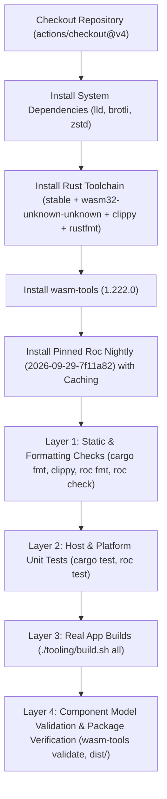

# Specification: Unit 03 — Roc in CI

- **Unit:** 03
- **File:** `docs/specs/03-roc-in-ci.md`
- **Status:** Spec written
- **Fixes:** `KI-08`, rest of `KI-12`, `KI-19`

---

## 1. Goal

Consolidate duplicate and divergent GitHub Actions workflows (`ci.yaml` and `ci.yml`) into a single, unified, dependable CI pipeline (`.github/workflows/ci.yaml`). Install the pinned toolchain (Roc nightly `2026-09-29-7f11a82`, Rust `wasm32-unknown-unknown`, LLVM `lld`/`wasm-ld`, `wasm-tools 1.222.0`, `brotli`, `zstd`) in CI runners, and execute all verification layers (format checks, static type checks, unit tests, full multi-example WebAssembly compilation, and component validation) on every pull request and push to `main`.

---

## 2. Design & Architecture

### 2.1 The Problem
1. **Roc is Absent in CI (`KI-08`):** Neither `ci.yaml` nor `ci.yml` installs the Roc compiler. CI only runs `cargo test` against the mock `guest_bridge.rs`. Real Roc code is never compiled, checked, or tested in CI.
2. **Duplicate & Conflicting Workflows (`KI-12`):**
   - Two files exist: `.github/workflows/ci.yaml` and `.github/workflows/ci.yml`.
   - `ci.yaml` pins `wasm-tools` to `1.220.0`, while `ci.yml` uses `1.222.0`.
   - `ci.yml` invokes `cargo test --all-targets`, which fails on Linux due to GNU `ld` version-script errors unless `cdylib` is excluded (`KI-19`).
   - One workflow attempts `./tooling/build.sh all`, which immediately fails in GitHub Actions because `roc` and `wasm-ld` are missing.

### 2.2 Unified Workflow Pipeline (`.github/workflows/ci.yaml`)
Consolidate all tasks into a single workflow with modular jobs or organized steps:



#### Job Configuration Details:
1. **Triggers:**
   - Push to `main`.
   - Pull requests targeting `main`.
   - Tag pushes matching `v*`.

2. **System Toolchain Setup:**
   ```bash
   sudo apt-get update && sudo apt-get install -y lld brotli zstd
   # Ensure wasm-ld is discoverable in PATH
   if ! command -v wasm-ld &>/dev/null; then
       sudo ln -s $(which lld) /usr/local/bin/wasm-ld || true
   fi
   ```

3. **Pinned Roc Installation & Cache:**
   - Use `actions/cache@v4` caching `$HOME/.roc-cache` keyed by the pinned nightly version string: `roc-nightly-2026-09-29-7f11a82`.
   - Download asset: `https://github.com/roc-lang/nightlies/releases/download/nightly-2026-09-29-7f11a82/roc_nightly-linux_x86_64-2026-09-29-7f11a82.tar.gz`.
   - Extract and add binary directory to `$GITHUB_PATH`.
   - Verify `roc version` matches `nightly-2026-09-29-7f11a82`.

4. **Wasm Tools Installation:**
   - Use `bytecodealliance/actions/wasm-tools/setup@v1` with `version: "1.222.0"`.

5. **Layer 1: Static Analysis & Code Standards:**
   - `cargo fmt --manifest-path host/Cargo.toml --all -- --check`
   - `cargo clippy --manifest-path host/Cargo.toml --features stub-guest --lib -- -D warnings`
   - `roc fmt --check platform/main.roc examples/counter/main.roc examples/ai_tool/main.roc examples/streaming_agent/main.roc examples/canary_release/main.roc tests/envelope.roc`
   - `roc check platform/main.roc`
   - `roc check examples/counter/main.roc`
   - `roc check examples/ai_tool/main.roc`
   - `roc check examples/streaming_agent/main.roc`
   - `roc check examples/canary_release/main.roc`

6. **Layer 2: Unit Tests (TDD):**
   - Host test suite: `cargo test --manifest-path host/Cargo.toml --features stub-guest --lib` (19 unit tests).
   - Platform envelope unit tests: `roc test tests/envelope.roc`.

7. **Layer 3: Full App Builds & Packaging:**
   - Precompile host and build all agents: `./tooling/build.sh all`.
   - Validate WebAssembly component model conformance for all 4 agents:
     - `wasm-tools validate build/counter_agent.wasm`
     - `wasm-tools validate build/ai_tool_agent.wasm`
     - `wasm-tools validate build/streaming_agent_agent.wasm`
     - `wasm-tools validate build/canary_release_agent.wasm`
   - Verify release packages and hashes:
     - `test -f dist/checksums.txt`
     - `test -f dist/release_notes.md`

8. **File Cleanup:**
   - Remove redundant `.github/workflows/ci.yml`.

---

## 3. Implementation Steps

1. **Delete `.github/workflows/ci.yml`:** Remove the redundant and outdated workflow file.
2. **Author `.github/workflows/ci.yaml`:**
   - Integrate all dependencies, caches, checks, tests, builds, and validations into a clean, well-annotated workflow.
3. **Local Tooling Alignment:**
   - Verify that all commands specified in the CI workflow execute cleanly on the Linux environment.
4. **Documentation Updates:**
   - Update `docs/specs/00-build-plan.md` to reflect Unit 03 progress.
   - Update `docs/progress-tracker.md` to record resolution of `KI-08`, `KI-12`, and `KI-19`.

---

## 4. Deliverables & Modified Files

- `.github/workflows/ci.yaml`: Unified GitHub Actions CI pipeline.
- `.github/workflows/ci.yml`: Removed.
- `docs/specs/03-roc-in-ci.md`: This specification file.
- `docs/specs/00-build-plan.md`: Update Unit 03 status.
- `docs/progress-tracker.md`: Mark `KI-08` and `KI-12` as resolved.

---

## 5. Verification Criteria

- [ ] Redundant `.github/workflows/ci.yml` is removed.
- [ ] `.github/workflows/ci.yaml` installs pinned `roc nightly-2026-09-29-7f11a82`.
- [ ] `.github/workflows/ci.yaml` pins `wasm-tools 1.222.0`.
- [ ] CI runs `cargo fmt --check`, `cargo clippy`, and `cargo test --features stub-guest --lib`.
- [ ] CI runs `roc fmt --check` and `roc check` for platform and all 4 examples.
- [ ] CI runs `roc test tests/envelope.roc`.
- [ ] CI runs `./tooling/build.sh all` and validates all four generated agent components.
- [ ] All commands defined in CI are verified to pass locally before push.
