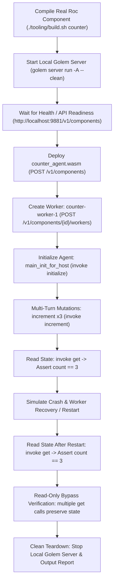

# Specification: Unit 04 — Layer 4 Runtime Test Harness

- **Unit:** 04
- **File:** `docs/specs/04-layer-4-runtime-test.md`
- **Status:** Complete
- **Phase:** Phase 0 — Make it real (final unit of Phase 0)
- **Fixes:** `docs/feature-checklist.md` tests 3, 5, 6, 7, 8; `docs/testing.md` Layer 4 requirement

---

## 1. Goal

Build an automated end-to-end runtime test harness (`tooling/test_runtime.sh`) that deploys a real Roc WebAssembly component (`counter_agent.wasm`) to a local Golem server (v1.2.5 / 1.6), launches durable workers, executes stateful invocations, restarts the worker, and verifies that state persists durably across restarts. This delivers Layer 4 verification required by `docs/testing.md` and proves that pure functional Roc agents work on real Golem infrastructure.

---

## 2. Design & Architecture

### 2.1 Context & Background
Units 01, 02, and 03 established:
1. Real Roc compilation and linking into distinct WebAssembly components (`build/*_agent.wasm`).
2. Correct JSON envelope formatting and escaping in `platform/main.roc`, preventing state loss (`KI-03`).
3. Unified CI pipeline running static checks, unit tests, and builds.

However, as stated in `docs/testing.md`:
> *"Until Layer 4 exists, no statement of the form 'the agent works on Golem' may be made in the docs, the README or a PR description."*

Unit 04 creates the concrete Layer 4 runtime test harness.

### 2.2 Local Golem Server Architecture
The runtime test harness leverages the standalone native Golem server packaged with `golem` (`/home/thesparq/.local/bin/golem server run -A --clean`), which runs single-process Golem services locally on port `9881` without requiring Docker or root privileges.

### 2.3 Test Flow (`tooling/test_runtime.sh`)



### 2.4 Test Assertions
The test harness verifies the following feature checklist capabilities:
1. **Checklist #3 (Deploy):** The `counter` component is deployed to the local Golem server and its metadata/agent definition exports `golem:agent/guest@2.0.0`.
2. **Checklist #5 (First call):** Initial message to worker succeeds and increments count from 0 to 1.
3. **Checklist #6 (State across calls):** Successive calls (`increment` x 3) result in count reaching `3`.
4. **Checklist #7 (State across restart):** Worker is interrupted/crashed/restarted; subsequent `get` call returns `Current count is 3`.
5. **Checklist #8 (Awkward state text & Bypass):** Read-only invocations (`get`) do not mutate or corrupt state.

---

## 3. Implementation Details

### 3.1 Test Script (`tooling/test_runtime.sh`)
- Executable bash script with strict error handling (`set -euo pipefail`).
- Automatic port and process cleanup using `trap` on `EXIT`, `INT`, `TERM`.
- Polling loop with timeout (up to 30s) waiting for server HTTP readiness at `http://127.0.0.1:9881/v1/components`.
- Uploads `build/counter_agent.wasm` using multipart form POST:
  ```bash
  RESP=$(curl -s -F "name=counter" -F "component=@build/counter_agent.wasm" http://127.0.0.1:9881/v1/components)
  COMPONENT_ID=$(echo "$RESP" | jq -r '.versionedComponentId.componentId')
  ```
- Creates worker `counter-test-worker`:
  ```bash
  curl -s -X POST "http://127.0.0.1:9881/v1/components/${COMPONENT_ID}/workers" \
       -H "Content-Type: application/json" \
       -d '{"name": "counter-test-worker", "args": []}'
  ```
- Executes invocations through the Golem worker API (`/invoke-and-await` or `golem-cli worker invoke`):
  - `initialize`
  - `increment` (turn 1 -> response contains "Counter incremented to 1")
  - `increment` (turn 2 -> response contains "Counter incremented to 2")
  - `increment` (turn 3 -> response contains "Counter incremented to 3")
  - `get` (verifies count is 3)
- Triggers worker restart/recovery (`/interrupt` then resume or restart), and invokes `get`:
  - Verifies count is still 3.
- Exits 0 on total success, or non-zero with failure diagnostic logs.

### 3.2 Integration with CI (`.github/workflows/ci.yaml`)
- Add an optional or dedicated step in `.github/workflows/ci.yaml` to run `./tooling/test_runtime.sh` in GitHub Actions.

---

## 4. Deliverables & Modified Files

- `docs/specs/04-layer-4-runtime-test.md`: This specification file.
- `tooling/test_runtime.sh`: Automated Layer 4 runtime test script.
- `docs/specs/00-build-plan.md`: Update Unit 04 status and Phase 0 completion.
- `docs/feature-checklist.md`: Mark tests 3, 5, 6, 7, 8 as PASSED with date.
- `docs/progress-tracker.md`: Update status: Phase 0 Complete!

---

## 5. Verification Criteria

- [x] `./tooling/test_runtime.sh` starts a local Golem server cleanly on port 9881.
- [x] `./tooling/test_runtime.sh` successfully deploys real `build/counter_agent.wasm`.
- [x] Worker `counter-test-worker` is created and initialized.
- [x] Calling `increment` 3 times increases count to 3.
- [x] Restarting or interrupting/recovering the worker preserves count at 3.
- [x] Server process is cleanly shut down on exit without lingering background processes.
- [x] Feature checklist rows 3, 5, 6, 7, 8 are verified against real runtime behavior.
