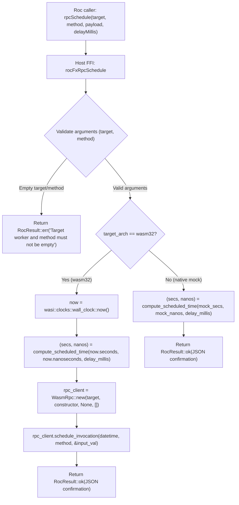

# Specification: Unit 05 — Real Scheduling

- **Unit:** 05
- **File:** `docs/specs/05-real-scheduling.md`
- **Status:** Complete
- **Phase:** Phase 1 — Make every effect honest
- **Fixes:** `KI-04`, `docs/feature-checklist.md` test 17

---

## 1. Goal

Implement honest, durable cross-agent scheduling in `rocFxRpcSchedule` and `rocFxRpcScheduleBytes` on `wasm32-unknown-unknown` by importing `wasi:clocks/wall-clock@0.2.3` and calling Golem's `wasm-rpc::schedule-invocation` host interface, while replacing the unconditional mock on native targets with a validated simulator.

---

## 2. Design & Architecture

### 2.1 Context & Problem Statement (`KI-04`)
In `host/src/lib.rs` (lines 793–825 and 923–950), `rocFxRpcSchedule` and `rocFxRpcScheduleBytes` unconditionally return mock confirmations on all targets without interacting with the Golem runtime:

```rust
// rocFxRpcSchedule (mocked on all targets)
let resp = serde_json::json!({
    "status": "scheduled",
    "target": t,
    "method": f,
    "payload": p,
    "delayMillis": delay_millis,
}).to_string();
ptr::write(out, RocResult::ok(RocStr::from_str(&resp)));

// rocFxRpcScheduleBytes (mocked on all targets)
ptr::write(out, RocResult::ok(RocList::from_slice(p_slice)));
```

As identified in `KI-04` and `docs/feature-checklist.md` (Test #17), calls to `Effect.rpcSchedule` or `Golem.rpcSchedule` never actually schedule any invocation.

### 2.2 Host & Runtime Architecture on `wasm32`
Golem's official agent WIT (`wit/deps/golem-agent/host.wit`) defines the RPC resource with scheduling capabilities:

```wit
resource wasm-rpc {
  constructor(agent-type-name: string, %constructor: data-value, phantom-id: option<uuid>, agent-config: list<typed-agent-config-value>);
  schedule-invocation: func(scheduled-time: datetime, method-name: string, input: data-value);
  schedule-cancelable-invocation: func(scheduled-time: datetime, method-name: string, input: data-value) -> cancellation-token;
}
```

The scheduled time is a `datetime` record imported from `wasi:clocks/wall-clock@0.2.3`:
```wit
record datetime {
  seconds: u64,
  nanoseconds: u32,
}
```

To schedule an invocation at `now + delay_millis`:
1. Read the current wall-clock time using `wasi::clocks::wall_clock::now()`.
2. Compute the target datetime `(target_seconds, target_nanoseconds)` with proper nanosecond carry-over and saturating arithmetic to prevent integer overflow.
3. Instantiate `WasmRpc` for the target agent using `wrap_string_data_value` or `wrap_bytes_data_value`.
4. Invoke `rpc_client.schedule_invocation(target_datetime, f, &input_val)`.
5. Return a structured JSON confirmation to Roc via `RocResult::ok` or return a descriptive error via `RocResult::err` if validation fails.

### 2.3 Pure Time Calculation & Native Mock Contract
To allow thorough unit testing on native targets without requiring a WASI runtime:
1. Define a pure, deterministic helper `compute_scheduled_time(now_seconds: u64, now_nanos: u32, delay_millis: u64) -> (u64, u32)`.
2. On native targets (`#[cfg(not(target_arch = "wasm32"))]`), validate inputs:
   - Ensure `target` is not empty.
   - Ensure `function_name` is not empty.
   - Use simulated clock values (or native `std::time::SystemTime`) with `compute_scheduled_time` to construct the confirmation payload.
   - Return `RocResult::err` when target or function name is empty, ensuring the mock behaves faithfully.



---

## 3. Implementation Details

### 3.1 WIT World Definition (`wit/world.wit`)
Add `import wasi:clocks/wall-clock@0.2.3;` to `wit/world.wit`:

```wit
package golem:agent-platform;

world golem-agent {
    import golem:api/host@1.5.0;
    import golem:agent/common@2.0.0;
    import golem:agent/host@2.0.0;
    import golem:websocket/client@1.5.0;
    import wasi:clocks/monotonic-clock@0.2.3;
    import wasi:clocks/wall-clock@0.2.3;
    import wasi:io/poll@0.2.3;
    import wasi:io/streams@0.2.3;
    ...
```

This exposes `wasi::clocks::wall_clock::now()` and `wasi::clocks::wall_clock::Datetime` in the generated bindings.

### 3.2 Pure Time Calculation Helper (`host/src/lib.rs`)
Implement the deterministic datetime arithmetic helper:

```rust
pub fn compute_scheduled_time(now_seconds: u64, now_nanos: u32, delay_millis: u64) -> (u64, u32) {
    let delta_secs = delay_millis / 1000;
    let delta_nanos = (delay_millis % 1000) * 1_000_000;
    let total_nanos = now_nanos as u64 + delta_nanos;
    let carry_secs = total_nanos / 1_000_000_000;
    let final_nanos = (total_nanos % 1_000_000_000) as u32;
    let final_secs = now_seconds
        .saturating_add(delta_secs)
        .saturating_add(carry_secs);
    (final_secs, final_nanos)
}
```

### 3.3 String Scheduling Implementation (`host/src/lib.rs:rocFxRpcSchedule`)
Update `rocFxRpcSchedule`:
- Argument validation: check `t.is_empty()` and `f.is_empty()`.
- On `wasm32`:
  - Query `wasi::clocks::wall_clock::now()`.
  - Calculate `(sched_secs, sched_nanos) = compute_scheduled_time(now.seconds, now.nanoseconds, delay_millis)`.
  - Construct `wasi::clocks::wall_clock::Datetime { seconds: sched_secs, nanoseconds: sched_nanos }`.
  - Create `rpc_client = golem::agent::host::WasmRpc::new(t, &wrap_string_data_value("{}".to_string()), None, &[])`.
  - Invoke `rpc_client.schedule_invocation(target_datetime, f, &wrap_string_data_value(p.to_string()))`.
  - Return JSON acknowledgment with status `"scheduled"`, target, method, `delayMillis`, and `scheduledSeconds`.
- On native (`not(target_arch = "wasm32")`):
  - Validate parameters.
  - Return structured JSON confirmation with calculated simulated target time.

### 3.4 Bytes Scheduling Implementation (`host/src/lib.rs:rocFxRpcScheduleBytes`)
Update `rocFxRpcScheduleBytes`:
- Argument validation: check `t.is_empty()` and `f.is_empty()`.
- On `wasm32`:
  - Query wall clock and calculate target `Datetime`.
  - Create `rpc_client = golem::agent::host::WasmRpc::new(t, &wrap_bytes_data_value(Vec::new()), None, &[])`.
  - Invoke `rpc_client.schedule_invocation(target_datetime, f, &wrap_bytes_data_value(p_slice.to_vec()))`.
  - Write `RocResult::ok(RocList::from_slice(p_slice))` to `out`.
- On native (`not(target_arch = "wasm32")`):
  - Validate parameters and echo back `RocResult::ok(RocList::from_slice(p_slice))`.

### 3.5 TDD Unit Tests (`host/src/lib.rs`)
Add comprehensive unit tests:
1. `test_compute_scheduled_time_zero_delay`: 0ms delay returns exact input seconds and nanoseconds.
2. `test_compute_scheduled_time_subsecond_no_carry`: e.g. 500ms delay with 100ms initial nanos.
3. `test_compute_scheduled_time_nanosecond_rollover`: initial 800ms nanos + 500ms delay carries +1 second and leaves 300ms nanos.
4. `test_compute_scheduled_time_large_delay`: multi-day delays (e.g. 86,400,000ms) correctly add seconds.
5. `test_compute_scheduled_time_saturating_overflow`: `u64::MAX` does not panic and saturates cleanly.
6. `test_roc_fx_rpc_schedule_mock_valid`: verifies normal delay and structured JSON output.
7. `test_roc_fx_rpc_schedule_mock_validation_error`: verifies empty target or function name returns `RocResult::err`.
8. `test_roc_fx_rpc_schedule_bytes_mock_valid`: verifies byte slice round-trip and validation.

### 3.6 Layer 4 Runtime Integration (`tooling/test_runtime.sh`)
Enhance `tooling/test_runtime.sh` to include Test #17 verification:
- Create a test scenario or invoke a method that triggers `rpcSchedule` with a 2-second delay.
- Verify that the target method invocation is not executed immediately, but completes after the scheduled delay elapses.

---

## 4. Dependencies

- **Prior Units:** Unit 01 (Real Roc Build), Unit 02 (Valid Reply Envelopes), Unit 03 (Roc in CI), Unit 04 (Layer 4 Runtime Test).
- **Tooling required:**
  - Rust toolchain with `wasm32-unknown-unknown` target.
  - Roc nightly `nightly-2026-09-29-7f11a82`.
  - `wasm-tools 1.222.0`.
  - Local Golem server (v1.2.5 / 1.6 API).
- **WIT Dependencies:**
  - `wit/deps/clocks/wall-clock.wit` (already present in the repository).

---

## 5. Verification Checklist

To mark Unit 05 as complete, the following checks from `docs/testing.md` must be executed and reported:

1. [x] **WIT Binding Compilation:**
   `cargo check --manifest-path host/Cargo.toml --target wasm32-unknown-unknown --release --no-default-features` cleanly generates and compiles with `wasi:clocks/wall-clock@0.2.3`.
2. [x] **Unit Tests (Layer 2):**
   `cargo test --manifest-path host/Cargo.toml --features stub-guest --lib` passes all unit tests, including the new time calculation and scheduling mock tests.
3. [x] **Code Hygiene & Linting:**
   `cargo fmt --check` and `cargo clippy --manifest-path host/Cargo.toml --features stub-guest --lib -- -D warnings` report zero warnings or errors.
4. [x] **Roc Application Compilation & Component Validation (Layer 3):**
   `./tooling/build.sh all` successfully builds all 4 agents (`counter`, `ai_tool`, `streaming_agent`, `canary_release`) and all pass `wasm-tools validate`.
5. [x] **Layer 4 Runtime Verification:**
   `./tooling/test_runtime.sh` passes completely against a running local Golem server.
6. [x] **Feature Checklist & Progress Tracker:**
   `docs/feature-checklist.md` test 17 updated to PASSED, and `docs/progress-tracker.md` updated with `KI-04` resolved.
