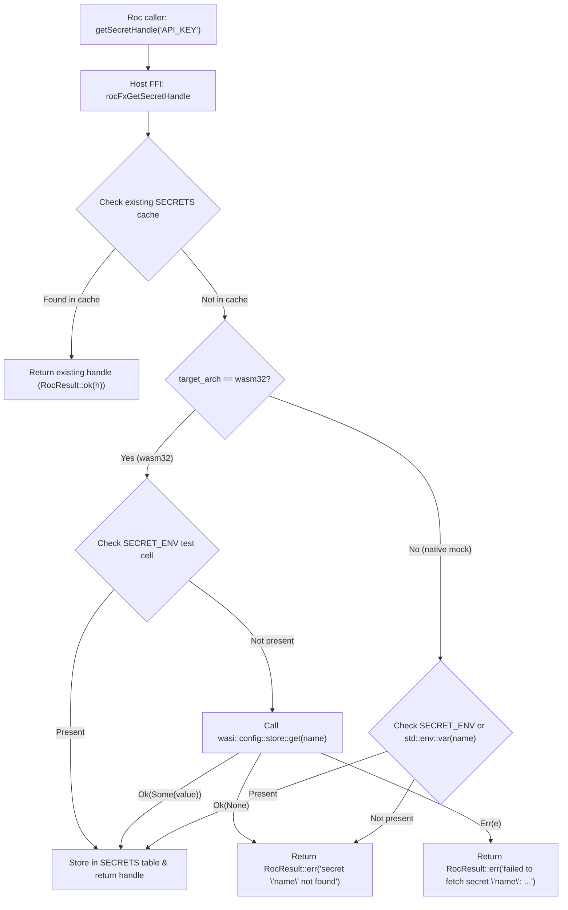

# Specification: Unit 06 — Secrets from Golem

- **Unit:** 06
- **File:** `docs/specs/06-secrets-from-golem.md`
- **Status:** Spec written
- **Phase:** Phase 1 — Make every effect honest
- **Fixes:** `KI-05`, `docs/feature-checklist.md` tests 25, 26

---

## 1. Goal

Connect `rocFxGetSecretHandle` to real target configuration and secret storage on `wasm32-unknown-unknown` via `wasi:config/store@0.2.0-draft`, returning an opaque `SecretHandle` when present and a descriptive error when absent, while preserving native test capability via `SECRET_ENV` and process environment fallback (`KI-05`).

---

## 2. Design & Architecture

### 2.1 Context & Problem Statement (`KI-05`)
In `host/src/lib.rs` (lines 1316–1360), `rocFxGetSecretHandle` resolves secrets as follows:

```rust
let secret_val = SECRET_ENV
    .with(|env| env.borrow().get(n).cloned())
    .or_else(|| std::env::var(n).ok());
```

On `wasm32-unknown-unknown`, `std::env::var(n)` always fails because WASI environment variable access is not routed through standard library process APIs. `SECRET_ENV` is an in-memory test cell that starts empty. Consequently, in production WebAssembly components running on Golem, all attempts to acquire a secret handle fail with `secret '<name>' not found`.

### 2.2 Host & Runtime Architecture on `wasm32`
The repository's WIT world (`wit/world.wit`) already imports `wasi:config/store@0.2.0-draft`:

```wit
package golem:agent-platform;

world golem-agent {
    ...
    import wasi:config/store@0.2.0-draft;
    ...
}
```

The `wasi:config/store` interface (`wit/deps/config/store.wit`) provides:
```wit
interface store {
    variant error {
        upstream(string),
        io(string),
    }

    get: func(key: string) -> result<option<string>, error>;
    get-all: func() -> result<list<tuple<string, string>>, error>;
}
```

This interface is the standard mechanism on Golem and WASI 0.2 for accessing worker environment configurations and secrets configured on components/workers.

### 2.3 Secret Lifecycle & Security Model
1. **Opaque Handles**: `rocFxGetSecretHandle` returns a `u32` handle (`SecretHandle` in Roc) corresponding to an entry in the host's internal `SECRETS` table.
2. **Memory Isolation**: Secret plaintext remains isolated in the host's linear memory. Guest Roc state never holds the secret plaintext unless explicitly requested via `revealSecret`.
3. **Out-of-Band HTTP Ingestion**: When constructing outgoing HTTP requests with `secretHeaders`, the host retrieves the secret by handle from `SECRETS` and injects the header directly into the request:
   ```rust
   let full_value = format!("{}{}", prefix, entry.value);
   fields.set(&name_string, &[full_value.as_bytes().to_vec()]);
   ```
4. **Idempotency**: Repeated requests for the same secret name return the existing allocated handle without duplicating storage.



---

## 3. Implementation Details

### 3.1 Host FFI Implementation (`host/src/lib.rs:rocFxGetSecretHandle`)
Update `rocFxGetSecretHandle`:
- Validate input: return `RocResult::err("empty secret name")` if `name` is null or empty.
- Cache lookup: return existing handle if already present in `SECRETS`.
- Target-specific resolution:
  - On `wasm32`:
    - First check `SECRET_ENV` (allowing unit/integration testing overrides).
    - If absent, call `wasi::config::store::get(n)`.
    - If `Ok(Some(val))`: store in `SECRETS` via `store_secret(n.to_string(), val)` and return `RocResult::ok(h)`.
    - If `Ok(None)`: return `RocResult::err(RocStr::from_str(&format!("secret '{}' not found", n)))`.
    - If `Err(e)`: return `RocResult::err(RocStr::from_str(&format!("failed to fetch secret '{}': {:?}", n, e)))`.
  - On native (`not(target_arch = "wasm32")`):
    - Check `SECRET_ENV`.
    - If absent, check `std::env::var(n)`.
    - If found: store and return handle.
    - If not found: return `RocResult::err(RocStr::from_str(&format!("secret '{}' not found", n)))`.

### 3.2 Secret Reveal FFI (`host/src/lib.rs:rocFxRevealSecret`)
- Preserve validation: return `RocResult::err("invalid secret handle <handle>")` for unallocated or 0 handles.
- Return `RocResult::ok(RocStr::from_str(&entry.value))` for valid handles.

### 3.3 TDD Unit Tests (`host/src/lib.rs`)
Add unit tests under `mod tests`:
1. `test_secret_get_handle_found`: verify acquiring a handle for an existing secret via `SECRET_ENV` succeeds.
2. `test_secret_get_handle_idempotent`: verify calling `rocFxGetSecretHandle` twice for the same secret returns the identical handle.
3. `test_secret_get_handle_missing`: verify querying an unconfigured secret returns descriptive `secret '<name>' not found`.
4. `test_secret_get_handle_empty`: verify empty or null secret name returns `empty secret name`.
5. `test_secret_reveal_valid`: verify revealing a valid handle produces the secret plaintext.
6. `test_secret_reveal_invalid`: verify revealing handle 0 or an out-of-range handle returns `invalid secret handle <handle>`.
7. `test_secret_header_injection_mock`: verify HTTP request header builder retrieves secret by handle and injects formatted header.

### 3.4 Runtime Test Integration (`tooling/test_runtime.sh`)
- Confirm `./tooling/test_runtime.sh` continues to pass cleanly on local Golem server.

---

## 4. Dependencies

- **Prior Units:** Unit 04 (Layer 4 Runtime Test), Unit 05 (Real Scheduling).
- **Tooling required:**
  - Rust toolchain with `wasm32-unknown-unknown` target.
  - Roc nightly `nightly-2026-09-29-7f11a82`.
  - `wasm-tools 1.222.0`.
  - Local Golem server (v1.2.5 / 1.6 API).
- **WIT Dependencies:**
  - `wasi:config/store@0.2.0-draft` (already imported in `wit/world.wit`).

---

## 5. Verification Checklist

To mark Unit 06 as complete, the following checks from `docs/testing.md` must be executed and reported:

1. [ ] **Clean Host Compilation for wasm32:**
   `cargo check --manifest-path host/Cargo.toml --target wasm32-unknown-unknown --release --no-default-features` cleanly compiles with `wasi::config::store`.
2. [ ] **Unit Tests (Layer 2):**
   `cargo test --manifest-path host/Cargo.toml --features stub-guest --lib` passes all unit tests, including new secret lookup, idempotency, and missing secret tests.
3. [ ] **Code Hygiene & Linting:**
   `cargo fmt --check` and `cargo clippy --manifest-path host/Cargo.toml --features stub-guest --lib -- -D warnings` report zero warnings or errors.
4. [ ] **Roc Application Compilation & Component Validation (Layer 3):**
   `./tooling/build.sh all` successfully builds all 4 agents (`counter`, `ai_tool`, `streaming_agent`, `canary_release`) and all pass `wasm-tools validate`.
5. [ ] **Layer 4 Runtime Verification:**
   `./tooling/test_runtime.sh` passes completely against a running local Golem server.
6. [ ] **Feature Checklist & Progress Tracker:**
   `docs/feature-checklist.md` tests 25 & 26 updated, and `docs/progress-tracker.md` updated with `KI-05` resolved.
