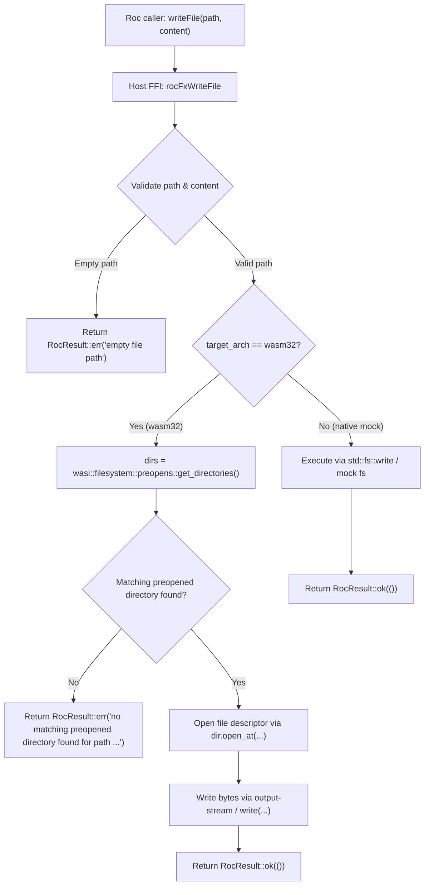

# Specification: Unit 07 — Real File Effects via WASI Filesystem

- **Unit:** 07
- **File:** `docs/specs/07-file-effects.md`
- **Status:** Complete
- **Phase:** Phase 1 — Make every effect honest
- **Fixes:** `KI-06`, `docs/feature-checklist.md` test 33

---

## 1. Goal

Implement honest file effects (`readFile`, `writeFile`, `appendFileBytes`, `readFileBytes`, and `writeFileBytes`) on `wasm32-unknown-unknown` using standard WASI 0.2 `wasi:filesystem/preopens@0.2.3` and `wasi:filesystem/types@0.2.3`, providing real durable file I/O within preopened directories, while preserving native `std::fs` fallback for local development and unit tests (`KI-06`).

---

## 2. Design & Architecture

### 2.1 Context & Problem Statement (`KI-06`)
In `host/src/lib.rs` (lines 1650–1735), all file effect functions unconditionally call Rust standard library filesystem APIs:
- `std::fs::read`
- `std::fs::write`
- `std::fs::OpenOptions::new().append(true)`
- `std::fs::read_to_string`

On `wasm32-unknown-unknown`, Rust's standard library does not implement `std::fs`. Any invocation of file effects on real WebAssembly guests either traps or returns an OS error (`unsupported` / `Operation not supported on this target`). Furthermore, `wit/world.wit` does not currently import `wasi:filesystem`, leaving the WebAssembly component without filesystem capabilities.

### 2.2 Host & Runtime Architecture on `wasm32`
The repository already vendor-bundles WASI filesystem definitions in `wit/deps/filesystem/`:
- `preopens.wit` (`wasi:filesystem/preopens@0.2.3`)
- `types.wit` (`wasi:filesystem/types@0.2.3`)

Importing these interfaces into `wit/world.wit`:
```wit
import wasi:filesystem/types@0.2.3;
import wasi:filesystem/preopens@0.2.3;
```
allows the Rust host to interact with real WASI 0.2 filesystem capabilities exposed by Golem workers and WASI runtimes.

### 2.3 Sandboxed Path Resolution & Preopens
WASI 0.2 filesystem security requires all file access to be relative to a preopened directory descriptor:
1. `wasi::filesystem::preopens::get_directories()` returns a list of `(Descriptor, String)` representing preopened root/directory mappings (e.g. `[(desc, "/")]`, `[(desc, ".")]`, or `[(desc, "/data")]`).
2. **Path Matching**:
   - Normalize target path (strip redundant `./` prefixes, leading slashes, and resolve path components).
   - Find the best matching preopened descriptor whose mount prefix is a prefix of the normalized path.
   - Extract the relative subpath relative to that preopened descriptor.
   - If no preopened directories exist or no prefix matches, return a descriptive error:
     `"no matching preopened directory found for path '<path>'"`
3. **Descriptor Operations**:
   - **Read**: Open descriptor via `dir.open_at(PathFlags::empty(), subpath, OpenFlags::empty(), DescriptorFlags::READ)`. Read via `desc.read_via_stream(0)` or `desc.read(length, offset)` until EOF.
   - **Write**: Open descriptor via `dir.open_at(PathFlags::empty(), subpath, OpenFlags::CREATE | OpenFlags::TRUNCATE, DescriptorFlags::WRITE | DescriptorFlags::MUTATE_DIRECTORY)`. Write buffer via `desc.write_via_stream(0)` or `desc.write(buffer, 0)` and flush.
   - **Append**: Open descriptor via `dir.open_at(PathFlags::empty(), subpath, OpenFlags::CREATE, DescriptorFlags::WRITE | DescriptorFlags::MUTATE_DIRECTORY)`. Append buffer using `desc.append_via_stream()`.

### 2.4 Native Development & Mock Architecture
- On native (`not(target_arch = "wasm32")`):
  - Continue using `std::fs` operations with appropriate directory creation and error translation, allowing local development and host test suites to execute without a full WASI host runtime.
  - Add in-memory virtual file fallback (`MOCK_FS`) for hermetic unit testing where temporary disk access is undesired.



---

## 3. Implementation Details

### 3.1 WIT World Specification (`wit/world.wit`)
Add WASI 0.2 filesystem imports to `wit/world.wit`:
```wit
package golem:agent-platform;

world golem-agent {
    import golem:api/host@1.5.0;
    import golem:agent/common@2.0.0;
    import golem:agent/host@2.0.0;
    import golem:websocket/client@1.5.0;
    import wasi:clocks/monotonic-clock@0.2.3;
    import wasi:clocks/wall-clock@0.2.3;
    import wasi:filesystem/types@0.2.3;
    import wasi:filesystem/preopens@0.2.3;
    import wasi:io/poll@0.2.3;
    import wasi:io/streams@0.2.3;
    ...
```

### 3.2 Preopen Helper Module (`host/src/fs_bridge.rs` or `host/src/lib.rs`)
Implement helper utilities for WASI filesystem resolution:
1. `find_preopened_dir(path: &str) -> Result<(Descriptor, String), String>`:
   - Iterates through `wasi::filesystem::preopens::get_directories()`.
   - Matches mount path against target path and returns the active descriptor and relative subpath.
2. `read_descriptor_to_end(desc: &Descriptor) -> Result<Vec<u8>, String>`:
   - Reads all bytes using input stream or chunked `read` until EOF.
3. `write_descriptor_bytes(desc: &Descriptor, bytes: &[u8]) -> Result<(), String>`:
   - Writes byte payload and synchronizes descriptor.
4. `append_descriptor_bytes(desc: &Descriptor, bytes: &[u8]) -> Result<(), String>`:
   - Appends byte payload via `append_via_stream`.

### 3.3 Host FFI Implementations (`host/src/lib.rs`)
Update the 5 FFI entry points:
- `rocFxReadFileBytes(path, out)`
- `rocFxWriteFileBytes(path, bytes, out)`
- `rocFxAppendFileBytes(path, bytes, out)`
- `rocFxReadFile(path, out)`
- `rocFxWriteFile(path, content, out)`

Each entry point:
- Validates that `path` is not null or empty (returns `RocResult::err("empty file path")`).
- On `wasm32`: executes via `wasi::filesystem` using preopened descriptors; maps error codes to clear descriptive strings.
- On native: executes via `std::fs` or mock filesystem; returns `RocResult::ok` on success and descriptive `RocResult::err` on failure.

### 3.4 TDD Unit Tests (`host/src/lib.rs`)
Add unit tests under `mod tests`:
1. `test_fs_write_and_read_string_roundtrip`: write string to file and read back, asserting contents match.
2. `test_fs_write_and_read_bytes_roundtrip`: write binary byte sequence (including non-UTF8 bytes `0xFF, 0x00, 0xAA`) and read back identically.
3. `test_fs_append_bytes`: write initial bytes, append additional bytes, assert full concatenated output.
4. `test_fs_read_nonexistent_file`: reading non-existent path returns descriptive error.
5. `test_fs_empty_path`: calling read or write with empty string returns `empty file path` error.
6. `test_fs_path_normalization`: paths with `./` or multiple slashes normalize predictably.

### 3.5 Layer 4 Runtime Test Verification (`tooling/test_runtime.sh`)
- Confirm `./tooling/test_runtime.sh` continues to deploy and pass cleanly against local Golem server.
- Validate that the component world with `wasi:filesystem` deploys cleanly to Golem server (1.6 API).

---

## 4. Dependencies

- **Prior Units:** Unit 04 (Layer 4 Runtime Test), Unit 05 (Real Scheduling), Unit 06 (Secrets from Golem).
- **Tooling required:**
  - Rust toolchain with `wasm32-unknown-unknown` target.
  - Roc nightly `nightly-2026-09-29-7f11a82`.
  - `wasm-tools 1.222.0`.
  - Local Golem server (v1.2.5 / 1.6 API).
- **WIT Dependencies:**
  - `wit/deps/filesystem/types.wit` and `preopens.wit` (already present in repository).

---

## 5. Verification Checklist

To mark Unit 07 as complete, the following checks from `docs/testing.md` must be executed and reported:

1. [x] **Clean Host Compilation for wasm32:**
   `cargo check --manifest-path host/Cargo.toml --target wasm32-unknown-unknown --release --no-default-features` cleanly compiles with `wasi:filesystem`.
2. [x] **Unit Tests (Layer 2):**
   `cargo test --manifest-path host/Cargo.toml --features stub-guest --lib` passes all unit tests, including new file read, write, append, and binary roundtrip tests.
3. [x] **Code Hygiene & Linting:**
   `cargo fmt --check` and `cargo clippy --manifest-path host/Cargo.toml --features stub-guest --lib -- -D warnings` report zero warnings or errors.
4. [x] **Roc Application Compilation & Component Validation (Layer 3):**
   `./tooling/build.sh all` successfully builds all 4 agents (`counter`, `ai_tool`, `streaming_agent`, `canary_release`) and all pass `wasm-tools validate`.
5. [x] **Layer 4 Runtime Verification:**
   `./tooling/test_runtime.sh` passes completely against a running local Golem server.
6. [x] **Feature Checklist & Progress Tracker:**
   `docs/feature-checklist.md` test 33 updated, and `docs/progress-tracker.md` updated with `KI-06` resolved.
