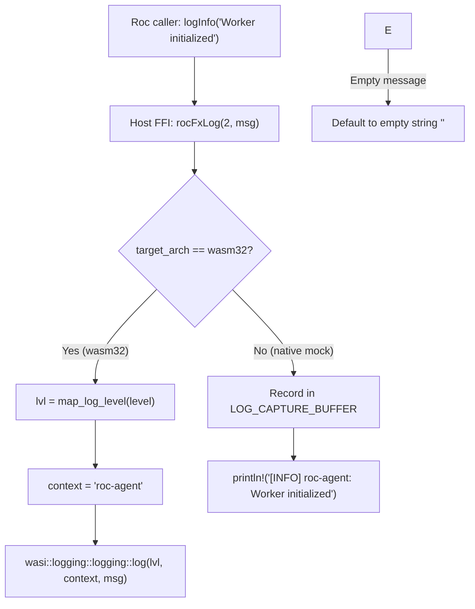

# Specification: Unit 08 — Real Logging via WASI Logging

- **Unit:** 08
- **File:** `docs/specs/08-logging.md`
- **Status:** Spec written
- **Phase:** Phase 1 — Make every effect honest
- **Fixes:** `KI-07`, `docs/feature-checklist.md` test 34

---

## 1. Goal

Route `rocFxLog` on `wasm32-unknown-unknown` to standard WASI logging via `wasi:logging/logging` so that guest log messages appear directly in Golem worker logs with structured priority levels (`trace`, `debug`, `info`, `warn`, `error`, `critical`), while retaining structured formatted output and an in-memory test capture buffer on native targets (`KI-07`).

---

## 2. Design & Architecture

### 2.1 Context & Problem Statement (`KI-07`)
In `host/src/lib.rs` (lines 959–971), `rocFxLog` is currently implemented using unrouted Rust `println!`:

```rust
#[no_mangle]
pub unsafe extern "C" fn rocFxLog(level: u8, msg: *const RocStr) {
    let m = if msg.is_null() { "" } else { (*msg).as_str() };
    let tag = match level {
        0 => "[TRACE]",
        1 => "[DEBUG]",
        2 => "[INFO]",
        3 => "[WARN]",
        4 => "[ERROR]",
        _ => "[LOG]",
    };
    println!("{} {}", tag, m);
}
```

On `wasm32-unknown-unknown`, WebAssembly standard I/O stdout is either discarded or unindexed by the Golem host if WASI logging is not wired. Furthermore, `wit/world.wit` does not import `wasi:logging/logging`, even though `wit/deps/logging/logging.wit` is present in the repository. As a result, worker logs in Golem do not capture structured log levels, context, or indexed events emitted by Roc agents.

### 2.2 Host & Runtime Architecture on `wasm32`
The repository bundles `wasi:logging/logging.wit`:
```wit
package wasi:logging;

interface logging {
    enum level {
       trace,
       debug,
       info,
       warn,
       error,
       critical,
    }

    log: func(level: level, context: string, message: string);
}
```

Adding `import wasi:logging/logging;` to `wit/world.wit` generates Rust bindings under `wasi::logging::logging`:
- `wasi::logging::logging::Level` (`Trace`, `Debug`, `Info`, `Warn`, `Error`, `Critical`)
- `wasi::logging::logging::log(level: Level, context: &str, message: &str)`

### 2.3 Level Mapping & Context Convention
In Roc, `platform/Effect.roc` defines:
```roc
match level {
    Trace => 0,
    Debug => 1,
    Info => 2,
    Warn => 3,
    Error => 4,
}
```
In `host/src/lib.rs`, map `level: u8`:
- `0` -> `wasi::logging::logging::Level::Trace`
- `1` -> `wasi::logging::logging::Level::Debug`
- `2` -> `wasi::logging::logging::Level::Info`
- `3` -> `wasi::logging::logging::Level::Warn`
- `4` -> `wasi::logging::logging::Level::Error`
- `>= 5` -> `wasi::logging::logging::Level::Critical`

**Context Parameter**:
Use `"roc-agent"` (or active agent type from `WORKER_STATE` if available) as the logging context string so consumers and log aggregators can filter and group messages effectively.

### 2.4 Native Development & Test Buffer
To enable deterministic unit testing without a WASI host:
- Maintain an in-memory log capture buffer `LOG_CAPTURE_BUFFER: GlobalCell<Vec<(u8, String, String)>>` (level, context, message) or thread-local storage on native.
- `rocFxLog` pushes to `LOG_CAPTURE_BUFFER` in addition to printing to stdout/stderr.
- Provide a test helper `pub fn get_captured_logs() -> Vec<(u8, String, String)>` and `pub fn clear_captured_logs()`.



---

## 3. Implementation Details

### 3.1 WIT World Specification (`wit/world.wit`)
Add `import wasi:logging/logging;` to `wit/world.wit`:
```wit
package golem:agent-platform;

world golem-agent {
    import golem:api/host@1.5.0;
    import golem:agent/common@2.0.0;
    import golem:agent/host@2.0.0;
    import golem:websocket/client@1.5.0;
    import wasi:clocks/monotonic-clock@0.2.3;
    import wasi:clocks/wall-clock@0.2.3;
    import wasi:filesystem/types@0.2.3;
    import wasi:filesystem/preopens@0.2.3;
    import wasi:logging/logging;
    import wasi:io/poll@0.2.3;
    import wasi:io/streams@0.2.3;
    ...
```

### 3.2 Host Logging Implementation (`host/src/lib.rs`)
1. Implement helper:
   ```rust
   #[cfg(target_arch = "wasm32")]
   fn map_wasi_log_level(level: u8) -> wasi::logging::logging::Level {
       match level {
           0 => wasi::logging::logging::Level::Trace,
           1 => wasi::logging::logging::Level::Debug,
           2 => wasi::logging::logging::Level::Info,
           3 => wasi::logging::logging::Level::Warn,
           4 => wasi::logging::logging::Level::Error,
           _ => wasi::logging::logging::Level::Critical,
       }
   }
   ```
2. Update `rocFxLog`:
   ```rust
   #[no_mangle]
   pub unsafe extern "C" fn rocFxLog(level: u8, msg: *const RocStr) {
       let m = if msg.is_null() { "" } else { (*msg).as_str() };
       let context = "roc-agent";

       #[cfg(target_arch = "wasm32")]
       {
           let wasi_level = map_wasi_log_level(level);
           wasi::logging::logging::log(wasi_level, context, m);
       }

       #[cfg(not(target_arch = "wasm32"))]
       {
           capture_test_log(level, context.to_string(), m.to_string());
           let tag = match level {
               0 => "[TRACE]",
               1 => "[DEBUG]",
               2 => "[INFO]",
               3 => "[WARN]",
               4 => "[ERROR]",
               _ => "[CRITICAL]",
           };
           println!("{} {}: {}", tag, context, m);
       }
   }
   ```

### 3.3 TDD Unit Tests (`host/src/lib.rs`)
Add unit tests under `mod tests`:
1. `test_logging_all_levels`: emit logs at levels 0..=5 and verify they are captured with correct levels and context `"roc-agent"`.
2. `test_logging_empty_and_null_message`: verify logging an empty message or null pointer does not panic and logs `""`.
3. `test_logging_special_characters`: verify newlines, unicode, and JSON formatted strings log faithfully without corruption.

### 3.4 Multi-Layer Verification
1. `cargo test --manifest-path host/Cargo.toml --features stub-guest --lib`: all unit tests pass.
2. `cargo check --manifest-path host/Cargo.toml --target wasm32-unknown-unknown --release --no-default-features`: builds cleanly with `wasi:logging/logging`.
3. `./tooling/build.sh all`: all agents compile and validate with `wasm-tools validate`.
4. `./tooling/test_runtime.sh`: passes cleanly against local Golem server.

---

## 4. Dependencies

- **Prior Units:** Unit 04 (Layer 4 Runtime Test), Unit 07 (Real File Effects).
- **Tooling required:**
  - Rust toolchain with `wasm32-unknown-unknown` target.
  - Roc nightly `nightly-2026-09-29-7f11a82`.
  - `wasm-tools 1.222.0`.
  - Local Golem server (v1.2.5 / 1.6 API).
- **WIT Dependencies:**
  - `wit/deps/logging/logging.wit` (already present in repository).

---

## 5. Verification Checklist

To mark Unit 08 as complete, the following checks from `docs/testing.md` must be executed and reported:

1. [ ] **Clean Host Compilation for wasm32:**
   `cargo check --manifest-path host/Cargo.toml --target wasm32-unknown-unknown --release --no-default-features` cleanly compiles with `wasi:logging/logging`.
2. [ ] **Unit Tests (Layer 2):**
   `cargo test --manifest-path host/Cargo.toml --features stub-guest --lib` passes all unit tests, including new level mapping and buffer capture tests.
3. [ ] **Code Hygiene & Linting:**
   `cargo fmt --check` and `cargo clippy --manifest-path host/Cargo.toml --features stub-guest --lib -- -D warnings` report zero warnings or errors.
4. [ ] **Roc Application Compilation & Component Validation (Layer 3):**
   `./tooling/build.sh all` successfully builds all agent components and all pass `wasm-tools validate`.
5. [ ] **Layer 4 Runtime Verification:**
   `./tooling/test_runtime.sh` passes completely against a running local Golem server.
6. [ ] **Feature Checklist & Progress Tracker:**
   `docs/feature-checklist.md` test 34 updated to PASSED, and `docs/progress-tracker.md` updated with `KI-07` resolved.
