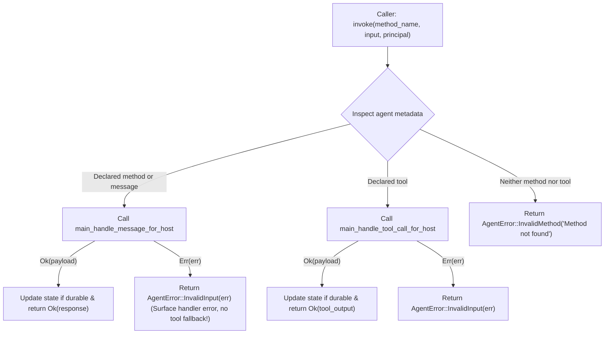

# Specification: Unit 09 — Surface Handler Errors

- **Unit:** 09
- **File:** `docs/specs/09-surface-handler-errors.md`
- **Status:** Spec written
- **Phase:** Phase 1 — Make every effect honest
- **Fixes:** `KI-10`, `docs/feature-checklist.md` tests 13, 14

---

## 1. Goal

Eliminate the indiscriminate tool fallback and error obfuscation in `host/src/lib.rs` (`KI-10`) so that failing message handlers surface their own application errors directly (`AgentError::InvalidInput(err)`), genuine tools are routed directly to tool handlers, and unknown methods return a clear `AgentError::InvalidMethod` error naming the missing method without attempting tool invocation.

---

## 2. Design & Architecture

### 2.1 Context & Problem Statement (`KI-10`)
In `host/src/lib.rs` (lines 3088–3155), `Guest::invoke` currently handles any error from `main_handle_message_for_host` by blindly falling back to tool invocation:

```rust
Err(err) => {
    // Fallback to tool invocation (support both kebab-case and snake_case)
    let tool_name = if method_name.contains('-') {
        method_name.replace('-', "_")
    } else {
        method_name.clone()
    };
    ...
    main_handle_tool_call_for_host(roc_out.as_mut_ptr(), &mut roc_state, &mut roc_call);
    ...
    match res {
        Ok(result_payload) => { ... }
        Err(_) => Err(AgentError::InvalidMethod(err.to_string())),
    }
}
```

This causes two severe defects:
1. **Unwanted Tool Invocation on Handler Failure**: If a declared method (e.g. `withdraw_funds` or `dangerous_action`) executes and returns an application error (e.g. `Err("insufficient balance")` or `Err("boom")`), the host interprets this as "method not found" and attempts to invoke a tool with the same name.
2. **Error Obfuscation**: When the tool invocation fails, the host discards the tool result and wraps the original error in `AgentError::InvalidMethod("insufficient balance")`. The caller is told that the method was invalid/non-existent, completely masking the actual application failure that occurred inside a valid method.

### 2.2 Desired Behavior & Routing Contract
In Golem WIT (`wit/deps/golem-agent/guest.wit`), `invoke` serves as the universal dispatch entry point for both methods and tools:
```wit
invoke: func(method-name: string, input: data-value, principal: principal) -> result<data-value, agent-error>;
```

And `agent-error` (`wit/deps/golem-agent/common.wit`) specifies:
```wit
variant agent-error {
  invalid-input(string),
  invalid-method(string),
  invalid-type(string),
  invalid-agent-id(string),
  custom-error(value-and-type),
}
```

The host must distinguish among three distinct dispatch cases based on the agent's declared metadata:
1. **Declared Typed Method** (or standard message `""`, `"handle-message"`, `"message"`):
   - Dispatch directly to `main_handle_message_for_host`.
   - On `Ok`: commit state (if durable) and return response.
   - On `Err(err)`: **Surface the handler error immediately** as `AgentError::InvalidInput(err)`. Do NOT attempt tool fallback.
2. **Declared Tool**:
   - Dispatch directly to `main_handle_tool_call_for_host`.
   - On `Ok`: commit state (if durable) and return tool output.
   - On `Err(err)`: Return `AgentError::InvalidInput(err)`.
3. **Unknown Method / Tool**:
   - If `method_name` is neither a declared method nor a declared tool:
     Return `AgentError::InvalidMethod(format!("Method '{}' not found", method_name))`.
   - If metadata contains no declared method or tool definitions (legacy/fallback):
     Call `main_handle_message_for_host`. If the error indicates method not found (`"Method ... not found"`), attempt tool call; otherwise surface `err` as `AgentError::InvalidInput(err)`.



---

## 3. Implementation Details

### 3.1 Metadata Inspection Helper (`host/src/lib.rs`)
Implement helper to extract declared methods and tools for an agent:
```rust
struct AgentCapabilities {
    methods: HashSet<String>,
    tools: HashSet<String>,
}

fn get_agent_capabilities(agent_name: &str) -> AgentCapabilities
```
- Inspects the JSON returned by `main_metadata_for_host`.
- For tools, inserts both the original name and normalized forms (snake_case and kebab-case) to ensure seamless tool calling regardless of naming convention.
- Includes default standard message names (`"handle-message"`, `"message"`, `""`).

### 3.2 Update `Guest::invoke` (`host/src/lib.rs`)
Refactor the dispatch logic in `Guest::invoke`:
1. Resolve active agent type and retrieve its `AgentCapabilities`.
2. Check if `method_name` is in `tools`:
   - If so, construct `tool_call_json` and invoke `main_handle_tool_call_for_host`.
   - Handle response or return `AgentError::InvalidInput(err)`.
3. Check if `method_name` is in `methods` (or capabilities are empty):
   - Construct message envelope and invoke `main_handle_message_for_host`.
   - On `Ok`: process envelope, update state, and return response.
   - On `Err(err)`:
     - If capabilities are empty and `err` indicates method not found (`err.contains("not found")`):
       attempt tool fallback.
     - Otherwise, surface the error: `Err(AgentError::InvalidInput(err.to_string()))`.
4. If `method_name` is not in `methods` and not in `tools`:
   - Return `Err(AgentError::InvalidMethod(format!("Method '{}' not found", method_name)))`.

### 3.3 Mock Guest Bridge Updates (`host/src/guest_bridge.rs`)
Add test hooks in `host/src/guest_bridge.rs` for native host testing:
- Add a failing method handler `fail_handler` (or `boom`) that returns `RocResult::err(RocStr::from_str("boom"))`.
- Ensure `main_metadata_for_host` in `guest_bridge.rs` declares `fail_handler` as a method.

### 3.4 TDD Unit Tests (`host/src/lib.rs`)
Add unit tests under `mod tests`:
1. `test_handler_error_surfaces_cleanly`:
   - Invoke `fail_handler` on an agent.
   - Assert result is `Err(AgentError::InvalidInput(msg))` where `msg == "boom"` (or contains `"boom"`).
   - Assert error is NOT `AgentError::InvalidMethod`.
2. `test_unknown_method_returns_invalid_method`:
   - Invoke `non_existent_method_xyz`.
   - Assert result is `Err(AgentError::InvalidMethod(msg))` where `msg.contains("non_existent_method_xyz")`.
3. `test_direct_tool_invocation`:
   - Invoke declared tool `analyze_logs` and `analyze-logs`.
   - Assert result is `Ok` with faults analyzed.
4. `test_declared_method_does_not_call_tool`:
   - Verify that when a method fails, tool handlers are not invoked.

### 3.5 Runtime Verification (`tooling/test_runtime.sh`)
- Execute `./tooling/test_runtime.sh` to ensure all existing runtime assertions pass.
- Verify checklist tests 13 and 14 against the test suite.

---

## 4. Dependencies

- **Prior Units:** Unit 02 (Valid Reply Envelopes), Unit 08 (Real Logging).
- **Tooling required:**
  - Rust toolchain with `wasm32-unknown-unknown` target.
  - Roc nightly `nightly-2026-09-29-7f11a82`.
  - `wasm-tools 1.222.0`.

---

## 5. Verification Checklist

To mark Unit 09 as complete, the following checks from `docs/testing.md` must be executed and reported:

1. [ ] **Clean Host Compilation for wasm32:**
   `cargo check --manifest-path host/Cargo.toml --target wasm32-unknown-unknown --release --no-default-features` cleanly compiles.
2. [ ] **Unit Tests (Layer 2):**
   `cargo test --manifest-path host/Cargo.toml --features stub-guest --lib` passes all unit tests, including new handler error, unknown method, and direct tool dispatch tests.
3. [ ] **Code Hygiene & Linting:**
   `cargo fmt --check` and `cargo clippy --manifest-path host/Cargo.toml --features stub-guest --lib -- -D warnings` report zero warnings or errors.
4. [ ] **Roc Application Compilation & Component Validation (Layer 3):**
   `./tooling/build.sh all` successfully builds all agent components and all pass `wasm-tools validate`.
5. [ ] **Layer 4 Runtime Verification:**
   `./tooling/test_runtime.sh` passes completely against a running local Golem server.
6. [ ] **Feature Checklist & Progress Tracker:**
   `docs/feature-checklist.md` tests 13 & 14 updated to PASSED, and `docs/progress-tracker.md` updated with `KI-10` resolved.
