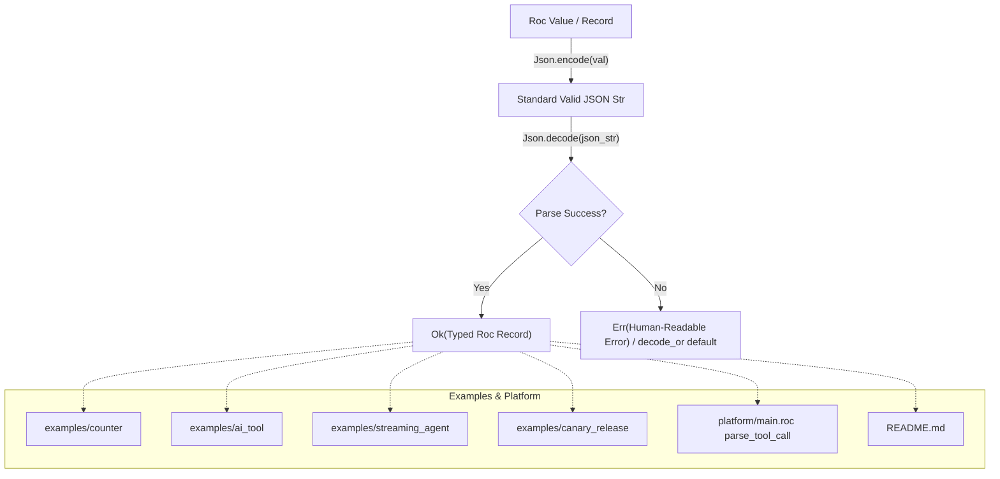

# Specification: Unit 10 — Shared JSON Helpers and Honest Examples

- **Unit:** 10
- **File:** `docs/specs/10-shared-json-helpers.md`
- **Status:** Spec written
- **Phase:** Phase 2 — Make the SDK and examples trustworthy
- **Fixes:** `KI-09`, `docs/feature-checklist.md` test 8 (Awkward state text)

---

## 1. Goal

Eliminate fragile ad-hoc JSON parsing (`Str.split_first`) across the SDK and all example agents (`KI-09`). Provide a standard, shared JSON codec module (`platform/Json.roc`, exposed through `platform/main.roc`), leveraging Roc's built-in `Json` primitives (`Json.to_str` and `Json.parse`). Update all four example agents (`counter`, `ai_tool`, `streaming_agent`, `canary_release`) and the `README.md` documentation to use the shared JSON helpers, ensuring full serialization and deserialization round-trip fidelity across whitespace, negative numbers, unicode, escaped characters, and nested data structures.

---

## 2. Design & Architecture

### 2.1 The Problem (`KI-09`)
Currently, every example agent parses JSON state using fragile string manipulation:
1. **Whitespace Fragility**: `Str.split_first(json, "\"key\":")` fails whenever JSON has whitespace after the colon (e.g. `{"count": 42}` or formatted JSON) because it expects `{"count":42}` without spaces.
2. **Missing Escaping**: In `examples/ai_tool/main.roc`, `serializeState` directly interpolates `state.lastTool` into the JSON string (`"\"lastTool\":\"${state.lastTool}\""`). If `lastTool` contains quotes, backslashes, tabs, or newlines, the resulting JSON is corrupt.
3. **Loss of State on Load in Documentation**: The `README.md` previously contained `deserializeState: |_json| Ok({ count: 0 })` which reset state to 0 on every turn, and even after partial fixes in Unit 02 still relies on manual `Str.split_first` parsing.
4. **Ad-hoc Duplication in Canary**: `examples/canary_release/Types.roc` and `ReleaseCoordinator.roc` duplicate ad-hoc extraction helpers (`extractStr`, `extractU64`, `extractStringList`), failing on whitespace or formatted arrays.
5. **Tool Call Parsing Fragility**: In `platform/main.roc`, `parse_tool_call` uses `extract_json_field` which matches exact `"\"${field}\":\""` strings, breaking if host tool call envelopes contain spaces after colons.

### 2.2 Built-in Roc JSON Capabilities
The pinned Roc compiler (`nightly-2026-09-29-7f11a82`) includes first-class JSON encoding and decoding built directly into the language runtime:
- `Json.to_str : a -> Str where [a.Encodable([])]`
- `Json.to_str_try : a -> Try(Str, err) where [a.Encodable(err)]`
- `Json.parse : Str -> Try(a, [InvalidJson(Str), ..errs]) where [a.Parseable([InvalidJson(Str), ..errs])]`

Roc records and primitive types (`I64`, `U64`, `U32`, `Bool`, `Str`, `List(a)`) automatically implement `Encodable` and `Parseable`.

### 2.3 Shared JSON Platform Module (`platform/Json.roc`)
We will provide a dedicated platform module `platform/Json.roc` exposed via `platform/main.roc` (`exposes: [Golem, Types, Json]`):

```roc
module [
	encode,
	decode,
	decode_or,
	escape,
]

import Types exposing [Result]

## Serializes any Encodable Roc record, list, or primitive into a valid JSON string.
encode : a -> Str where [a.Json.Encodable([])]
encode = |val|
	Json.to_str(val)

## Deserializes a JSON string into a Parseable Roc type, returning Result(a, Str).
decode : Str -> Result(a, Str) where [a.Json.Parseable([InvalidJson(Str), ..errs])]
decode = |json_str|
	match Json.parse(json_str) {
		Ok(val) => Ok(val),
		Err(InvalidJson(msg)) => Err("Invalid JSON: ${msg}"),
		Err(_) => Err("Failed to parse JSON"),
	}

## Deserializes a JSON string, or returns a fallback default value on error.
decode_or : Str, a -> a where [a.Json.Parseable([InvalidJson(Str), ..errs])]
decode_or = |json_str, default_val|
	match Json.parse(json_str) {
		Ok(val) => val,
		Err(_) => default_val,
	}

## Escapes special JSON characters (backslashes, quotes, newlines, carriage returns, tabs).
escape : Str -> Str
escape = |input|
	input
		|> Str.replace_each("\\", "\\\\")
		|> Str.replace_each("\"", "\\\"")
		|> Str.replace_each("\n", "\\n")
		|> Str.replace_each("\r", "\\r")
		|> Str.replace_each("\t", "\\t")
```



---

## 3. Implementation Details

### 3.1 Platform Updates
1. **Create `platform/Json.roc`**:
   - Implement `encode`, `decode`, `decode_or`, and `escape`.
2. **Update `platform/main.roc`**:
   - Expose `Json` module in platform header: `exposes [Golem, Types, Json]`.
   - Update `parse_tool_call`:
     Parse `{ id : Str, name : Str, arguments : Str }` using `Json.decode_or(raw_json, fallback_tool_call)` instead of sensitive `extract_json_field` string slicing.
   - Retain `escape_json_str` in `platform/main.roc` for reply envelope wrapping or delegate to `Json.escape`.

### 3.2 Refactoring Agent Examples
1. **`examples/counter/main.roc`**:
   - `serializeState`: `|state| Json.encode(state)`
   - `deserializeState`: `|json| Ok(Json.decode_or(json, { count: 0.I64 }))`
   - `handleToolCall` (`get_count`): `output: Json.encode({ count: state.count })`
2. **`examples/ai_tool/main.roc`**:
   - `serializeState`: `|state| Json.encode(state)`
   - `deserializeState`: `|json| Ok(Json.decode_or(json, { invocations: 0.I64, lastTool: "none" }))`
   - `handleToolCall`:
     - `calculator`: `output: Json.encode({ result: 42.I64 })`
     - `echo`: `output: Json.encode({ echo: toolCall.arguments })`
     - fallback: `output: Json.encode({ error: "Tool not found" })`
3. **`examples/streaming_agent/main.roc`**:
   - `serializeState`: `|state| Json.encode(state)`
   - `deserializeState`: `|json| Ok(Json.decode_or(json, { connected: False, handle: 0.U32, sent: 0.U64, received: 0.U64 }))`
   - `handleToolCall`:
     - `stream_message`: `output: Json.encode({ status: "stream_active", sent_count: state.sent })`
     - fallback: `output: Json.encode({ error: "Unknown tool ${toolCall.name}" })`
4. **`examples/canary_release/`**:
   - **`Types.roc`**:
     - Replace manual JSON string concatenation and `extractStr`/`extractU64`/`extractStringList` in:
       - `encodeStatus` and `decodeStatus`
       - `encodeLogBatch` and `decodeLogBatch`
       - `encodeDiagnosticReport` and `decodeDiagnosticReport`
       - `decodeRollbackInput`
     - Delete obsolete manual extractors (`extractStr`, `extractU64`, `extractStringList`).
   - **`ReleaseCoordinator.roc`**:
     - Remove unused duplicate `extractStr`.
5. **`README.md`**:
   - Update quickstart counter code to use `Json.encode` and `Json.decode_or(stateJson, { count: 0 })`.

### 3.3 Test Suite (`tests/json_roundtrip.roc`)
Create a comprehensive automated test suite `tests/json_roundtrip.roc` executable via `roc test tests/json_roundtrip.roc` and added to CI:
- **Primitives & Strings**: Round-trip integers (`I64`, `U64`, `U32`), booleans, strings with quotes, newlines, tabs, unicode, and emojis.
- **Whitespace Tolerance**: Verify JSON strings formatted with arbitrary indentation, spaces around colons, and line breaks parse into identical records.
- **Negative & Zero Numbers**: Verify `count: -100`, `0`, and positive numbers.
- **Agent State Round-Trips**:
  - Counter state: `{ count : I64 }`.
  - AI Tool state: `{ invocations : I64, lastTool : Str }` with malicious characters in `lastTool`.
  - Streaming Agent state: `{ connected : Bool, handle : U32, sent : U64, received : U64 }`.
  - Canary Release `Status`: `{ service, activeVersion, canaryVersion, weight, region, pendingTimerHandle, approvalWebhookUrl, events }`.
- **Tool Output Encodings**:
  - `echo` tool output encoding tool input containing quotes, backslashes, and newlines.
- **Tool Call Parsing Resilience**:
  - Verify `parse_tool_call` correctly parses tool envelopes with spaces after colons (`{"id": "call-1", "name": "echo", "arguments": "{}"}`).
- **Malformed JSON Handling**:
  - Graceful `Err` returns on malformed inputs without crashes.

### 3.4 CI Integration (`.github/workflows/ci.yaml`)
Add `roc test tests/json_roundtrip.roc` to Layer 2 unit testing stage in `.github/workflows/ci.yaml`.

---

## 4. Dependencies

- **Prior Units:** Unit 02 (Valid Reply Envelopes & State Escaping).
- **Tooling required:**
  - Roc nightly `nightly-2026-09-29-7f11a82`.
  - `wasm-tools 1.222.0`.
  - Rust toolchain with `wasm32-unknown-unknown` target.

---

## 5. Verification Checklist

To mark Unit 10 as complete, the following checks from `docs/testing.md` must be executed and reported:

1. [ ] **Unit Tests (Layer 2):**
   - `roc test tests/json_roundtrip.roc` passes all round-trip and edge-case tests.
   - `roc test tests/envelope.roc` continues to pass cleanly.
   - `cargo test --manifest-path host/Cargo.toml --features stub-guest --lib` passes all 27 host unit tests.
2. [ ] **Code Hygiene & Static Checks (Layer 1):**
   - `roc fmt --check` passes cleanly across platform, tests, and all examples.
   - `roc check platform/main.roc` and `roc check examples/*/main.roc` report zero errors.
   - `cargo fmt --check` and `cargo clippy --manifest-path host/Cargo.toml --features stub-guest --lib -- -D warnings` report zero warnings or errors.
3. [ ] **Component Build & Validation (Layer 3):**
   - `./tooling/build.sh all` successfully builds all four agent components.
   - `wasm-tools validate` validates all four `build/*_agent.wasm` binaries.
4. [ ] **Layer 4 Runtime Verification:**
   - `./tooling/test_runtime.sh` passes completely against a running local Golem server.
5. [ ] **Feature Checklist & Progress Tracker:**
   - `docs/feature-checklist.md` test 8 (Awkward state text) verified and marked PASSED.
   - `docs/progress-tracker.md` updated with `KI-09` marked resolved.
