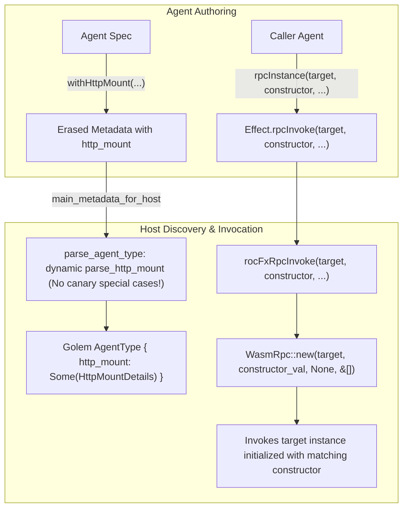

# Specification: Unit 11 — Platform Neutrality

- **Unit:** 11
- **File:** `docs/specs/11-platform-neutrality.md`
- **Status:** Spec written
- **Phase:** Phase 2 — Make the SDK and examples trustworthy
- **Fixes:** `KI-11`, `KI-13`, `docs/feature-checklist.md` test 18 (Address one instance)

---

## 1. Goal

Enforce Principle 10 of `docs/architecture.md` ("The platform and host contain no example-specific logic"):
1. **Metadata-Driven HTTP Mounts (`KI-11`)**: Remove the hard-coded `if name == "canary-release"` check in `host/src/lib.rs`. Allow any agent to declare HTTP mount configurations in its metadata via the SDK (`withHttpMount`), and have the host dynamically parse `HttpMountDetails` (`path_prefix`, `cors_options`, `webhook_suffix`).
2. **Target Instance Addressing via RPC Constructor (`KI-13`, Test #18)**: Upgrade the RPC effects across the C ABI, platform, and host to accept constructor arguments, allowing callers to address a specific worker instance (e.g. `canary-release` initialized with `{"service": "payment"}`) rather than always defaulting to an empty constructor (`"{}"`).

---

## 2. Design & Architecture

### 2.1 The Problem Statement

#### 2.1.1 Hard-Coded Example Logic (`KI-11`)
In `host/src/lib.rs` (lines 917–935), the host inspects the agent name during type discovery:
```rust
let http_mount = if name == "canary-release"
    || val.get("httpMount").is_some()
    || val.get("http_mount").is_some()
{
    Some(HttpMountDetails {
        path_prefix: vec![
            PathSegment::Literal("canary".to_string()),
            PathSegment::PathVariable(PathVariable {
                variable_name: "id".to_string(),
            }),
        ],
        ...
    })
} else {
    None
};
```
This violates Principle 10 by baking knowledge of the `canary-release` example directly into the host. Furthermore, any other agent attempting to mount an HTTP endpoint would receive the hardcoded `/canary/{id}` prefix instead of its own configured route.

#### 2.1.2 Inability to Address Specific Agent Instances via RPC (`KI-13`)
In Golem WIT (`wit/deps/golem-agent/host.wit`), remote agent invocations construct an RPC client using `wasm-rpc`:
```wit
resource wasm-rpc {
  constructor(agent-type-name: string, %constructor: data-value, phantom-id: option<uuid>, agent-config: list<typed-agent-config-value>);
  invoke-and-await: func(method-name: string, input: data-value) -> result<data-value, rpc-error>;
  ...
}
```
In Golem, worker instances of an agent type are keyed by their constructor parameters (the `input` data passed to `initialize`). In `host/src/lib.rs`, `rocFxRpcInvoke`, `rocFxRpcSchedule`, and `rocFxRpcFireAndForget` all hard-coded:
```rust
let constructor_val = wrap_string_data_value("{}".to_string());
let rpc_client = golem::agent::host::WasmRpc::new(t, &constructor_val, None, &[]);
```
Consequently, it is impossible for an agent to send an RPC call to any worker that was initialized with non-empty configuration parameters (such as `canary-release` configured for a specific service name).

### 2.2 Desired Behavior & Architecture

#### 2.2.1 Metadata-Driven HTTP Mounts
- In `platform/Types.roc`, define `HttpMount`:
  ```roc
  HttpMount : {
      pathPrefix : Str,
      corsOrigins : List(Str),
      webhookSuffix : Str,
  }
  ```
  And add `httpMount : [None, Some(HttpMount)]` to `Metadata`.
- In `platform/Golem.roc`, add builder function:
  ```roc
  withHttpMount : Spec(state), HttpMount -> Spec(state)
  withHttpMount = |spec, mount| { ..spec, httpMount: Some(mount) }
  ```
- In `platform/main.roc`, `format_agent_metadata` serializes `http_mount` when present.
- In `host/src/lib.rs`, delete `if name == "canary-release"`. Implement dynamic `parse_http_mount` that parses any path prefix (e.g. `/canary/{id}` or `/api/{tenant_id}/webhook`) into `PathSegment::Literal` and `PathSegment::PathVariable`, with configurable CORS and webhook suffix.
- In `examples/canary_release/ReleaseCoordinator.roc`, declare its mount explicitly via `withHttpMount`.

#### 2.2.2 RPC Constructor Arguments
- Upgrade the C ABI and platform effects:
  - `rocFxRpcInvoke(target, constructor, function_name, payload, out)`
  - `rocFxRpcSchedule(target, constructor, function_name, payload, delay_millis, out)`
  - `rocFxRpcFireAndForget(target, constructor, function_name, payload, out)`
  - And their respective binary bytes variants (`rocFxRpcInvokeBytes`, `rocFxRpcScheduleBytes`, `rocFxRpcFireAndForgetBytes`).
- In `platform/Golem.roc`:
  - Provide `rpcInstance`, `rpcScheduleInstance`, `rpcFireAndForgetInstance`, and typed/bytes variants that take explicit `(targetAgentType, constructorJson, method, payload)`.
  - Retain backwards-compatible `rpc(targetWorker, method, payload)` which delegates to `rpcInstance(targetWorker, "{}", method, payload)`.
- On `wasm32`, `host/src/lib.rs` passes `constructor` to `wrap_string_data_value(c.to_string())` (or bytes).
- On native mock, `host/src/lib.rs` returns structured JSON confirmation containing `"constructor": c`, enabling comprehensive unit testing.



---

## 3. Implementation Details

### 3.1 Platform Types & Builders (`platform/Types.roc`, `platform/Golem.roc`)
1. **`platform/Types.roc`**:
   - Define `HttpMount : { pathPrefix : Str, corsOrigins : List(Str), webhookSuffix : Str }`.
   - Update `Metadata` to include `httpMount : [None, Some(HttpMount)]`.
2. **`platform/Golem.roc`**:
   - Update `Spec(state)` to include `httpMount : [None, Some(HttpMount)]`.
   - Initialize `httpMount: None` in `define` and `defineEphemeral`.
   - Implement `withHttpMount : Spec(state), HttpMount -> Spec(state)`.
   - Update `build` to pass `httpMount: spec.httpMount` into `erased.metadata`.
   - Implement constructor-aware RPC functions:
     - `rpcInstance : Str, Str, Method(_in, _out), Str -> Effect.Effect(Result(Str, Str))`
     - `rpcScheduleInstance : Str, Str, Method(_in, _out), Str, U64 -> Effect.Effect(Result(Str, Str))`
     - `rpcFireAndForgetInstance : Str, Str, Method(_in, _out), Str -> Effect.Effect(Result(Str, Str))`
     - `rpcTypedInstance : Str, Str, Method(inp, out), inp, (inp -> Str), (Str -> Result(out, Str)) -> Effect.Effect(Result(out, Str))`
     - `rpcScheduleTypedInstance : Str, Str, Method(inp, out), inp, U64, (inp -> Str), (Str -> Result(out, Str)) -> Effect.Effect(Result(Str, Str))`
     - `rpcFireAndForgetTypedInstance : Str, Str, Method(inp, out), inp, (inp -> Str) -> Effect.Effect(Result(Str, Str))`
     - `rpcBytesInstance : Str, Str, Method(_in, _out), List(U8) -> Effect.Effect(Result(List(U8), Str))`
     - `rpcScheduleBytesInstance : Str, Str, Method(_in, _out), List(U8), U64 -> Effect.Effect(Result(List(U8), Str))`
     - `rpcFireAndForgetBytesInstance : Str, Str, Method(_in, _out), List(U8) -> Effect.Effect(Result({}, Str))`
   - Keep existing `rpc`, `rpcSchedule`, `rpcFireAndForget`, `rpcTyped`, etc. as default-constructor wrappers calling the instance variants with `constructor = "{}"`.

### 3.2 Platform Effects & Main (`platform/Effect.roc`, `platform/main.roc`)
1. **`platform/Effect.roc`**:
   - Update declarations and wrappers for `rocFxRpcInvoke`, `rocFxRpcSchedule`, `rocFxRpcFireAndForget`, and bytes variants to accept `constructor : Str` as the second argument.
2. **`platform/main.roc`**:
   - Update `format_agent_metadata` to serialize `"http_mount"` JSON object when `meta.httpMount` is `Some(mount)`.
   - Update `hosted` mappings to match the new effect signatures.

### 3.3 Host Dynamic Mount Parsing & Neutral RPC (`host/src/lib.rs`)
1. **Remove Special Case**: Delete `name == "canary-release"` check completely from `parse_agent_type`.
2. **Dynamic `parse_http_mount`**:
   - Parse `path_prefix`: split by `/`, map `{var}` to `PathSegment::PathVariable` and other tokens to `PathSegment::Literal`.
   - Parse `cors_options`: list of strings (defaulting to `["*"]`).
   - Parse `webhook_suffix`: split by `/` into `PathSegment::Literal` (defaulting to `vec![PathSegment::Literal("webhooks".to_string())]`).
3. **RPC Constructor Handling**:
   - In `rocFxRpcInvoke`, `rocFxRpcSchedule`, `rocFxRpcFireAndForget`, `rocFxRpcInvokeBytes`, `rocFxRpcScheduleBytes`, `rocFxRpcFireAndForgetBytes`:
     - Add `constructor: *const RocStr` parameter.
     - Extract `c = (*constructor).as_str()`.
     - On `wasm32`: create `constructor_val = wrap_string_data_value(c.to_string())` (or bytes).
     - On native mock: include `"constructor": c` in JSON response.

### 3.4 Mock Guest Bridge (`host/src/guest_bridge.rs`)
- Update `main_metadata_for_host` in `guest_bridge.rs`: add `"http_mount": { "path_prefix": "/canary/{id}" }` to `canary-release` agent metadata.

### 3.5 Example Refactoring (`examples/canary_release/ReleaseCoordinator.roc`)
- In `ReleaseCoordinator.agent`: add `|> withHttpMount({ pathPrefix: "/canary/{id}", corsOrigins: ["*"], webhookSuffix: "/webhooks" })`.

### 3.6 Skills & Documentation
- Update `.agents/skills/roc-golem.md` and `.gemini/skills/roc-golem.md` with `withHttpMount` and `rpcInstance`.

---

## 4. Dependencies

- **Prior Units:** Unit 04 (Layer 4 Runtime Test Harness), Unit 05 (Real Scheduling), Unit 10 (Shared JSON Helpers).
- **Tooling required:**
  - Rust toolchain with `wasm32-unknown-unknown` target.
  - Roc nightly `nightly-2026-09-29-7f11a82`.
  - `wasm-tools 1.222.0`.

---

## 5. Verification Checklist

To mark Unit 11 as complete, the following checks from `docs/testing.md` must be executed and reported:

1. [ ] **Unit Tests (Layer 2):**
   - Host unit tests verify that `canary-release` has an HTTP mount derived from its metadata, and that an agent without `httpMount` has `http_mount == None`.
   - Host unit tests verify custom path prefixes with path variables (e.g. `/api/{service}/events`) parse correctly into `PathVariable` segments.
   - Host unit tests verify `rocFxRpcInvoke`, `rocFxRpcSchedule`, and `rocFxRpcFireAndForget` transmit the specified constructor argument to the target worker.
   - Native RPC mock tests assert `"constructor"` is preserved in the response.
   - `cargo test --manifest-path host/Cargo.toml --features stub-guest --lib` passes all unit tests.
   - `roc test tests/json_roundtrip.roc` and `roc test tests/envelope.roc` pass cleanly.
2. [ ] **Code Hygiene & Static Checks (Layer 1):**
   - `roc fmt --check` passes across platform, tests, and all examples.
   - `roc check platform/main.roc` and `roc check examples/*/main.roc` report zero errors.
   - `cargo fmt --check` and `cargo clippy --manifest-path host/Cargo.toml --features stub-guest --lib -- -D warnings` report zero warnings or errors.
3. [ ] **Component Build & Validation (Layer 3):**
   - `./tooling/build.sh all` successfully builds all four agent components.
   - `wasm-tools validate` validates all four `build/*_agent.wasm` binaries.
4. [ ] **Layer 4 Runtime Verification:**
   - `./tooling/test_runtime.sh` passes completely against a running local Golem server.
5. [ ] **Feature Checklist & Progress Tracker:**
   - `docs/feature-checklist.md` test 18 (Address one instance) marked PASSED.
   - `docs/progress-tracker.md` updated with `KI-11` and `KI-13` marked resolved.
