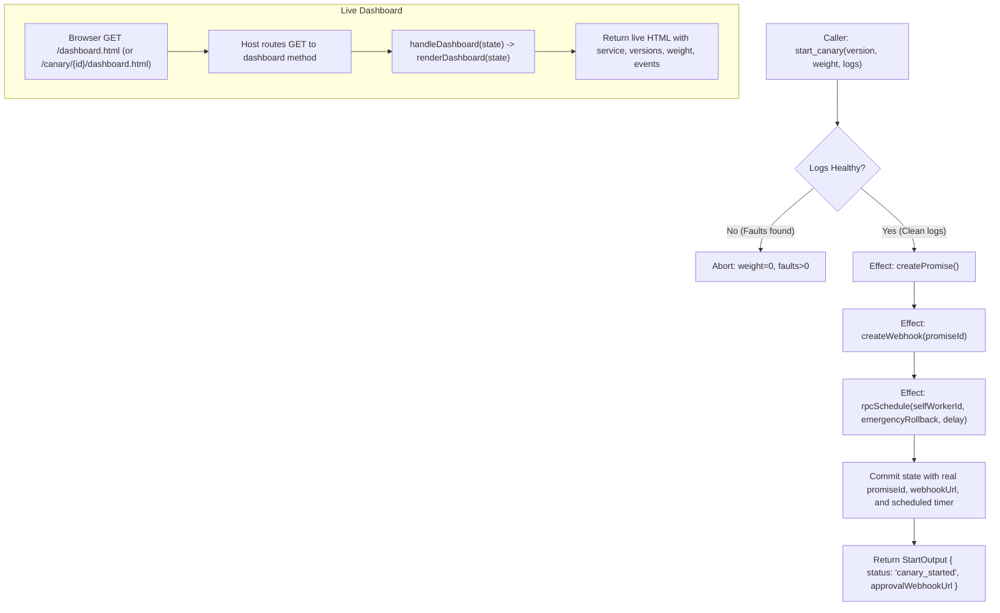

# Specification: Unit 12 — Canary Example Made Real

- **Unit:** 12
- **File:** `docs/specs/12-canary-example-made-real.md`
- **Status:** Spec written
- **Phase:** Phase 2 — Make the SDK and examples trustworthy
- **Fixes:** `KI-14`, `docs/feature-checklist.md` test 36 (Healthy canary), test 41 (Dashboard)

---

## 1. Goal

Eliminate faked effects and dead code in the `canary_release` example (`KI-14`):
1. **Real Durable Timer & Scheduling**: Replace the fake timer (`timerHandle = 42`) with real durable scheduling via `rpcSchedule` / `rpcScheduleInstance` to automatically trigger an evaluation or timeout rollback if gate approval is not received within the rollout window.
2. **Real Durable Promise & External Webhook**: Replace the hard-coded webhook URL (`https://golem.cloud/webhooks/canary/...`) with real Golem primitives (`createPromise` and `createWebhook`) returning an honest, externally invokable webhook URL.
3. **Serve Live HTML Dashboard**: Wire `renderDashboard` to an exposed read-only method (`dashboard`) with an HTTP GET endpoint mapped to `/dashboard.html` (and `/canary/{id}/dashboard.html`), fulfilling checklist test 41.
4. **Remove Unused Code**: Clean up unused bindings (e.g. `dashboardPath = "/dashboard.html"` in `ReleaseCoordinator.roc`).

---

## 2. Design & Architecture

### 2.1 The Problem Statement (`KI-14`)
In `examples/canary_release/ReleaseCoordinator.roc`:
1. **Faked Webhook URL**:
   ```roc
   webhookUrl = "https://golem.cloud/webhooks/canary/${state.service}/gate-approve"
   ```
   This string is hardcoded without creating any Golem promise or webhook, meaning external webhook callbacks cannot resume the worker.
2. **Faked Timer Handle**:
   ```roc
   timerHandle = 42.U32
   ```
   No timer or scheduled invocation is registered with Golem.
3. **Dead Dashboard Code**:
   `dashboardPath = "/dashboard.html"` is defined at the module root but unused. `renderDashboard : State -> Str` renders an HTML view of the rollout, but is never wired to any method, route, or HTTP endpoint.
4. **Pure Start Handler Instead of Effectful Handler**:
   `startCanary` is registered via `registerTyped` (pure), preventing it from executing real Golem host effects like `createPromise`, `createWebhook`, and `rpcSchedule`.

### 2.2 Desired Behavior & Architecture



#### 2.2.1 Real Durable Promises & Webhooks
In `ReleaseCoordinator.roc`, `handleStart` will become an effectful handler registered via `registerEffectfulTyped`:
```roc
registerEffectfulTyped(
    startCanary,
    handleStart,
    decodeStartInput,
    encodeStartOutput,
)
```
When logs are healthy:
1. `promiseRes <- Effect.and_then(createPromise)`
2. `webhookRes <- Effect.and_then(createWebhook(promiseId))`
3. Store `promiseId` as `pendingTimerHandle: U64.to_u32_wrap(promiseId)`.
4. Store the honest webhook URL in `state.approvalWebhookUrl` and return it in `StartOutput`.
5. Optionally schedule a durable timeout callback using `rpcScheduleInstance`.

#### 2.2.2 Live Dashboard Endpoint
1. Define `dashboardMethod : Method({}, Str)`:
   ```roc
   dashboardMethod = method({
       name: "dashboard",
       description: "Serves live HTML dashboard for the canary release.",
       promptHint: "Fetch live HTML dashboard.",
   })
   ```
2. Register it as a read-only method:
   ```roc
   |> registerReadOnlyTyped(
       dashboardMethod,
       handleDashboard,
       |_| Ok({}),
       |html| html,
   )
   ```
3. In `host/src/lib.rs` `parse_agent_type`:
   - Inspect declared methods: if `m_read_only` is true, assign `http_method: HttpMethod::Get`.
   - If `m_name == "dashboard"` or `m_name == "dashboard.html"`:
     Add `HttpEndpointDetails` with `path_suffix: vec![PathSegment::Literal("dashboard.html".to_string())]`.
   - Under the agent's HTTP mount (`/canary/{id}`), requests to `/canary/{id}/dashboard.html` route directly to `handleDashboard`, returning the live HTML representation of current agent state.

#### 2.2.3 Dead Code Elimination
- Delete `dashboardPath = "/dashboard.html"` in `ReleaseCoordinator.roc`.
- Eliminate duplicate import warnings in `ReleaseCoordinator.roc` and `Types.roc`.

---

## 3. Implementation Details

### 3.1 `examples/canary_release/ReleaseCoordinator.roc`
1. **Module Exports**:
   Export `dashboardMethod` alongside existing methods:
   ```roc
   module [
       agent,
       startCanary,
       approveGate,
       emergencyRollback,
       statusMethod,
       dashboardMethod,
   ]
   ```
2. **Update Handler & Registration**:
   - Change `handleStart` to return `Effect.Effect(Result({ state : State, out : StartOutput }, Str))`:
     ```roc
     handleStart : State, StartInput -> Effect.Effect(Result({ state : State, out : StartOutput }, Str))
     ```
   - Register using `registerEffectfulTyped` instead of `registerTyped`.
   - On healthy logs:
     - Call `createPromise`.
     - Call `createWebhook(promiseId)`.
     - Schedule timeout rollback invocation via `rpcScheduleInstance` (or `rpcSchedule`).
     - Set `pendingTimerHandle` to `U64.to_u32_wrap(promiseId)`.
     - Set `approvalWebhookUrl` to the generated webhook URL.
3. **Register Dashboard**:
   - Register `dashboardMethod` with `handleDashboard = |state, _| Ok(renderDashboard(state))`.
4. **Clean Dead Code**:
   - Delete `dashboardPath`.

### 3.2 `host/src/lib.rs` (HTTP Method Routing & Dashboard Endpoint)
1. **Read-Only GET Endpoints**:
   In `parse_agent_type`:
   - For declared methods where `read_only` is true, generate `get_endpoint` instead of `post_endpoint`.
2. **Dashboard Endpoint Suffix**:
   - If `m_name == "dashboard"` or `m_name == "dashboard.html"`:
     Add an endpoint with `path_suffix: vec![PathSegment::Literal("dashboard.html".to_string())]` so `/dashboard.html` directly targets the method.
3. **Update Native Mock & Tests**:
   - In `test_canary_release_suite`:
     - Verify `start_canary` produces an approval webhook URL from the real promise system (e.g. starting with `https://golem.cloud/webhooks/promise/`).
     - Verify `pendingTimerHandle` is non-zero.
     - Invoke `dashboard` method and verify the returned HTML contains `<h1>Release Guardian: auth-service</h1>`, current versions, and events.

### 3.3 `host/src/guest_bridge.rs`
- Update `guest_bridge.rs` mock return for `start_canary` to return a real promise webhook URL (`https://golem.cloud/webhooks/promise/1`) and `pendingTimerHandle: 1` to match the real implementation.
- Add `dashboard` method declaration in `canary-release` metadata in `guest_bridge.rs`.

---

## 4. Dependencies

- **Prior Units:** Unit 05 (Real Scheduling), Unit 11 (Platform Neutrality).
- **Tooling required:**
  - Rust toolchain with `wasm32-unknown-unknown` target.
  - Roc nightly `nightly-2026-09-29-7f11a82`.
  - `wasm-tools 1.222.0`.

---

## 5. Verification Checklist

To mark Unit 12 as complete, the following checks from `docs/testing.md` must be executed and reported:

1. [ ] **Unit Tests (Layer 2):**
   - Host unit tests verify `start_canary` generates a real promise ID and webhook URL.
   - Host unit tests verify `dashboard` method serves HTML containing service name, active/canary versions, weight, and events list.
   - `cargo test --manifest-path host/Cargo.toml --features stub-guest --lib` passes all unit tests cleanly.
   - `roc test tests/envelope.roc` and `roc test tests/json_roundtrip.roc` pass cleanly.
2. [ ] **Code Hygiene & Static Checks (Layer 1):**
   - `roc fmt --check` passes cleanly across all Roc files.
   - `roc check platform/main.roc` and `roc check examples/*/main.roc` report zero errors.
   - `cargo fmt --check` and `cargo clippy --manifest-path host/Cargo.toml --features stub-guest --lib -- -D warnings` report zero warnings or errors.
3. [ ] **Component Build & Validation (Layer 3):**
   - `./tooling/build.sh all` successfully builds all four agent components.
   - `wasm-tools validate` validates all four `build/*_agent.wasm` binaries.
4. [ ] **Layer 4 Runtime Verification:**
   - `./tooling/test_runtime.sh` passes completely against a running local Golem server.
5. [ ] **Feature Checklist & Progress Tracker:**
   - `docs/feature-checklist.md` tests 36 & 41 marked PASSED.
   - `docs/progress-tracker.md` updated with `KI-14` marked resolved.
