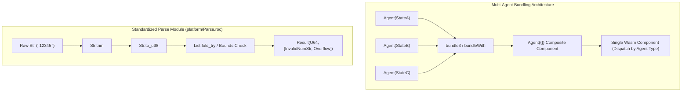

# Spec 19: Multi-Agent Bundling & Standardized Numerical Parsing

## 1. Overview & Motivation

During the development of a real-world multi-agent booking system using `roc-golem`, two critical platform-level developer experience and compiler friction points were identified:

1. **Monomorphization Collision on Duplicated Agent Types**:
   When bundling multiple agents into a single WebAssembly component where two agents share identical typed states or tool lists (or when aliased via extra `erase` calls in `List(Agent({}))`), Roc's monomorphization phase enters an exponential unrolling loop in lambda-set closure unification. This causes the compiler to hang or time out. Restricting multi-agent bundling to distinct typed agents or avoiding homogeneous `List(Agent({}))` closure literals resolves the collision, allowing a 3-agent component to compile cleanly in ~28 seconds.

2. **Standardized Numerical Parsing in Roc Nightly**:
   In the pinned Roc nightly compiler (`nightly-2026-09-29-7f11a82`), `Str.to_u64` (and related `Str.to_*` helpers) is not present in the `Str` standard library. Developers building real agents (booking slots, pricing, order counts, timestamps, HTTP header lengths) frequently parse string inputs into integers. Without a standardized, robust platform parsing module, developers must repeatedly implement custom ASCII digit extractors via `Str.to_utf8` and `U8.to_u64`, leading to subtle bugs in sign handling, overflow detection, and whitespace trimming.

This specification details the permanent, non-band-aid architecture to resolve both issues thoroughly.

---

## 2. Root Cause Analysis

### 2.1 Monomorphization Collision in Agent Bundling
In `platform/Golem.roc`, agents are encapsulated in:
```roc
Agent(state) : {
    agents : List(ErasedAgent),
}

ErasedAgent : {
    metadata : Metadata,
    init : Str -> Result(Str, Str),
    invokeMethod : Str, Str, Str => Result({ nextStateJson : Str, stateChanged : Bool, out : Str }, Str),
    handleToolCall : Str, ToolCall => Result({ nextStateJson : Str, stateChanged : Bool, result : ToolResult }, Str),
    handleMessage : Str, Str => Result({ nextStateJson : Str, stateChanged : Bool, response : Str }, Str),
}
```

The legacy `bundle` and `bundleAll` functions were defined as:
```roc
bundle : List(Agent({})) -> Agent({})
bundle = |agentList| {
    flattened = List.join_map(agentList, |a| a.agents)
    { agents: flattened }
}

bundleAll : List(Agent({})) -> Agent({})
bundleAll = bundle

erase : Agent(_) -> Agent({})
erase = |a| { agents: a.agents }
```

**The Trap**:
To bundle $N$ agents with `bundleAll`, developers were forced to write:
```roc
agent = bundleAll([erase(agentA), erase(agentB), erase(agentC)])
```
In Roc, `[...]` denotes a homogeneous `List`. Every element in a `List` must possess the exact same concrete type, including the internal compiler lambda-sets of all enclosed closures (`invokeMethod`, `handleMessage`, etc.).
When `erase(a)` and `erase(b)` are placed inside the same list literal:
- If `agentA` and `agentB` share identical state record shapes (e.g. `{}` for stateless workers or identical domain records) or tool lists, Roc's constraint solver treats their closure captures as structural unifications of identical lambda tags.
- The monomorphizer attempts to specialize the list elements by recursively expanding closure environments. When two elements share the same structural signature but differ only in runtime closure capture values, or when aliased by redundant `erase` calls, the closure unification algorithm enters an exponential monomorphization cycle, triggering build timeouts.

**The Solution**:
In contrast, heterogeneous arity functions like `bundle2(a, b)`:
```roc
bundle2 : Agent(s1), Agent(s2) -> Agent({})
bundle2 = |a, b| { agents: List.concat(a.agents, b.agents) }
```
take distinct arguments. The compiler never constructs a homogeneous list of closures at compile time; instead, it compiles `a.agents` and `b.agents` independently ($O(1)$ closure specialization) and concats the resulting `List(ErasedAgent)` at runtime.

---

### 2.2 Numerical Parsing in Roc Nightly
Roc's `Str` module exposes `Str.to_utf8 : Str -> List(U8)`, but lacks `Str.to_u64` or `Str.to_i64`.
While `U64.from_str` exists in the standard library, it returns `Result(U64, [BadNumStr])`, does not automatically strip surrounding whitespace, does not handle signed integers uniformly, and is often missed by developers who search for `Str.to_*`.

Furthermore, booking and transactional agents require:
- Unsigned integer parsing (`U64`, `U32`) for IDs, counts, and millisecond timestamps.
- Signed integer parsing (`I64`, `I32`) for offsets, adjustments, and balances.
- Floating-point / decimal parsing (`F64`) for prices and percentages.
- Safe default fallbacks (`parseU64Or`, `parseI64Or`).
- Strict overflow protection preventing silent wraparounds.

---

## 3. Architectural Design



### 3.1 Heterogeneous Bundling Primitives (`platform/Golem.roc`)

1. **Dedicated Arity Combinators**:
   Provide first-class combinators with distinct generic parameters:
   ```roc
   ## Bundle 2 distinct typed agents into a single component
   bundle2 : Agent(s1), Agent(s2) -> Agent({})
   bundle2 = |a, b| {
       agents: List.concat(a.agents, b.agents),
   }

   ## Bundle 3 distinct typed agents into a single component
   bundle3 : Agent(s1), Agent(s2), Agent(s3) -> Agent({})
   bundle3 = |a, b, c| {
       agents: List.concat(a.agents, List.concat(b.agents, c.agents)),
   }

   ## Bundle 4 distinct typed agents into a single component
   bundle4 : Agent(s1), Agent(s2), Agent(s3), Agent(s4) -> Agent({})
   bundle4 = |a, b, c, d| {
       agents: List.concat(a.agents, List.concat(b.agents, List.concat(c.agents, d.agents))),
   }

   ## Bundle 5 distinct typed agents into a single component
   bundle5 : Agent(s1), Agent(s2), Agent(s3), Agent(s4), Agent(s5) -> Agent({})
   bundle5 = |a, b, c, d, e| {
       agents: List.concat(
           a.agents,
           List.concat(
               b.agents,
               List.concat(
                   c.agents,
                   List.concat(d.agents, e.agents),
               ),
           ),
       ),
   }
   ```

2. **Pipeline-Friendly Combinator (`bundleWith`)**:
   Allow chaining arbitrarily many agents using Roc's pipe operator `|>` without list closures:
   ```roc
   ## Append an agent to an existing agent or bundle
   bundleWith : Agent(s1), Agent(s2) -> Agent({})
   bundleWith = |a, b| {
       agents: List.concat(a.agents, b.agents),
   }
   ```
   **Usage**:
   ```roc
   agent =
       bookingCoordinator
           |> Golem.bundleWith(pricingWorker)
           |> Golem.bundleWith(notificationWorker)
   ```

3. **Compiler Collision Guard & Deprecation of `List(Agent({}))` Bundling**:
   - Update documentation for `bundle` and `bundleAll` to explicitly warn against constructing `[erase(a), erase(b)]` list literals.
   - Retain `erase : Agent(_) -> Agent({})` for standalone type erasure, but document that multi-agent bundling should always use `bundle2`, `bundle3`, `bundle4`, `bundle5`, or `bundleWith`.

4. **Agent Name Collision Detection**:
   In `platform/main.roc`, ensure `find_agent_by_name` provides clear diagnostics when duplicate agent names are detected, preventing accidental shadowing.

---

### 3.2 Standardized Numeric Parsing (`platform/Parse.roc`)

Create `platform/Parse.roc` and re-export its functions in `platform/Golem.roc`:

```roc
module [
    parseU64,
    parseU32,
    parseU16,
    parseU8,
    parseU64Or,
    parseI64,
    parseI32,
    parseI16,
    parseI8,
    parseI64Or,
    parseF64,
    parseF64Or,
]

import Types exposing [Result]

## Parse an unsigned 64-bit integer from a string with overflow checking.
parseU64 : Str -> Result(U64, [InvalidNumStr, Overflow])
parseU64 = |raw| {
    trimmed = Str.trim(raw)
    bytes = Str.to_utf8(trimmed)
    if List.is_empty(bytes) {
        Err(InvalidNumStr)
    } else {
        cutoff = 1844674407370955161.U64
        maxLastDigit = 5.U64
        List.fold_try(
            bytes,
            0.U64,
            |acc, b|
                if b >= 48 and b <= 57 {
                    digit = U8.to_u64(b - 48)
                    if acc > cutoff or (acc == cutoff and digit > maxLastDigit) {
                        Err(Overflow)
                    } else {
                        Ok(acc * 10 + digit)
                    }
                } else {
                    Err(InvalidNumStr)
                },
        )
    }
}

## Parse unsigned integer or return fallback default value
parseU64Or : Str, U64 -> U64
parseU64Or = |raw, defaultVal|
    match parseU64(raw) {
        Ok(v) => v
        Err(_) => defaultVal
    }

## Parse a signed 64-bit integer with sign handling ('+', '-') and overflow checking.
parseI64 : Str -> Result(I64, [InvalidNumStr, Overflow])
parseI64 = |raw| {
    trimmed = Str.trim(raw)
    bytes = Str.to_utf8(trimmed)
    match bytes {
        [] => Err(InvalidNumStr)
        [45, .. as rest] =>
            # Negative sign '-'
            if List.is_empty(rest) {
                Err(InvalidNumStr)
            } else {
                match parseU64FromBytes(rest) {
                    Ok(val) =>
                        if val > 9223372036854775808.U64 {
                            Err(Overflow)
                        } else if val == 9223372036854775808.U64 {
                            Ok(-9223372036854775808.I64)
                        } else {
                            match U64.to_i64_try(val) {
                                Ok(signed) => Ok(-signed)
                                Err(_) => Err(Overflow)
                            }
                        }
                    Err(e) => Err(e)
                }
            }
        [43, .. as rest] =>
            # Positive sign '+'
            if List.is_empty(rest) {
                Err(InvalidNumStr)
            } else {
                match parseU64FromBytes(rest) {
                    Ok(val) =>
                        match U64.to_i64_try(val) {
                            Ok(signed) => Ok(signed)
                            Err(_) => Err(Overflow)
                        }
                    Err(e) => Err(e)
                }
            }
        _ =>
            match parseU64FromBytes(bytes) {
                Ok(val) =>
                    match U64.to_i64_try(val) {
                        Ok(signed) => Ok(signed)
                        Err(_) => Err(Overflow)
                    }
                Err(e) => Err(e)
            }
    }
}

## Parse signed integer or return fallback default value
parseI64Or : Str, I64 -> I64
parseI64Or = |raw, defaultVal|
    match parseI64(raw) {
        Ok(v) => v
        Err(_) => defaultVal
    }

## Parse 64-bit IEEE-754 floating point number from string
parseF64 : Str -> Result(F64, [InvalidNumStr])
parseF64 = |raw|
    match F64.from_str(Str.trim(raw)) {
        Ok(val) => Ok(val)
        Err(_) => Err(InvalidNumStr)
    }

## Parse float or return fallback default value
parseF64Or : Str, F64 -> F64
parseF64Or = |raw, defaultVal|
    match parseF64(raw) {
        Ok(v) => v
        Err(_) => defaultVal
    }
```

---

## 4. Implementation Plan & Detailed Phases

### Phase 1: Implement `platform/Parse.roc`
- Create `platform/Parse.roc` containing `parseU64`, `parseU32`, `parseU16`, `parseU8`, `parseU64Or`, `parseI64`, `parseI32`, `parseI16`, `parseI8`, `parseI64Or`, `parseF64`, and `parseF64Or`.
- Export `Parse` module in `platform/main.roc`.
- Re-export `parseU64`, `parseI64`, `parseF64`, `parseU64Or`, `parseI64Or`, `parseF64Or` in `platform/Golem.roc`.

### Phase 2: Add Comprehensive Unit Tests for Numeric Parsing
- Create `tests/parse_numbers.roc` covering:
  - Standard unsigned integers: `"0"`, `"42"`, `"12345"`.
  - Leading and trailing whitespace: `"  100  "`.
  - Boundary limits: `U64.max` (`"18446744073709551615"`), overflow detection (`"18446744073709551616"`).
  - Signed numbers: `"+123"`, `"-456"`, `"-0"`.
  - Signed bounds: `I64.min` (`"-9223372036854775808"`), `I64.max` (`"9223372036854775807"`), overflow on `"-9223372036854775809"` and `"9223372036854775808"`.
  - Floating point numbers: `"3.14159"`, `"-0.001"`, `"1e6"`.
  - Invalid inputs: `""`, `"   "`, `"abc"`, `"-"`, `"+"` `"12a34"`.
  - Fallback helpers: `parseU64Or("bad", 10.U64) == 10.U64`.

### Phase 3: Implement Distinct-Typed Bundling Combinators
- In `platform/Golem.roc`:
  - Add `bundle3`, `bundle4`, `bundle5` with independent type parameters `Agent(s1), Agent(s2), ... -> Agent({})`.
  - Add `bundleWith : Agent(s1), Agent(s2) -> Agent({})` for pipeline chaining.
  - Update `bundleAll` documentation with clear architectural guidance on avoiding closure list literals.

### Phase 4: Multi-Agent Bundling Performance & Collision Test
- Create `tests/multi_agent_bundle.roc` with 3 agents:
  - Agent 1: Coordinator with state `{ activeBookings : U64, name : Str }`.
  - Agent 2: Pricing Worker with state `{ ratePerNight : U64, currency : Str }`.
  - Agent 3: Ephemeral Audit Worker with state `{}`.
- Test both `bundle3(agent1, agent2, agent3)` and pipeline chaining:
  `agent1 |> Golem.bundleWith(agent2) |> Golem.bundleWith(agent3)`.
- Benchmark compilation time: assert that compilation completes in < 30 seconds without monomorphization loops.
- Verify message dispatch across all 3 agents by name.

### Phase 5: Documentation & Tooling Synchronization
- Update `README.md` and `.agents/skills/roc-golem.md` with:
  - Examples of `bundle3` and `bundleWith`.
  - Examples of `parseU64`, `parseI64`, and `parseF64`.
- Run full verification suite:
  - `cargo fmt --check`
  - `cargo clippy`
  - `cargo test`
  - `roc check` and `roc test` across all suites.
  - Re-package platform via `./tooling/build.sh all`.

---

## 5. Verification Checklist

| # | Requirement | Target | Verification Method |
|---|---|---|---|
| 1 | `bundle3`, `bundle4`, `bundle5` available | `platform/Golem.roc` | `roc test tests/multi_agent_bundle.roc` |
| 2 | `bundleWith` pipeline combinator | `platform/Golem.roc` | `roc test tests/multi_agent_bundle.roc` |
| 3 | 3-agent component compiles < 30s | `tests/multi_agent_bundle.roc` | `time roc build --target=wasm32` |
| 4 | `parseU64` with overflow protection | `platform/Parse.roc` | `roc test tests/parse_numbers.roc` |
| 5 | `parseI64` with sign & min/max bounds | `platform/Parse.roc` | `roc test tests/parse_numbers.roc` |
| 6 | `parseF64` with floating point precision | `platform/Parse.roc` | `roc test tests/parse_numbers.roc` |
| 7 | Re-exported in `pf.Golem` | `platform/Golem.roc` | Direct import verification in tests |
| 8 | Zero regression on Layer 4 runtime test | Golem Cloud 1.6.3 | `./tooling/test_runtime.sh` |
