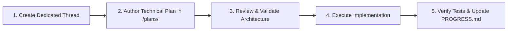

# Progress Archive: Historical Audit, Analysis & Architecture Notes

> **Source:** Migrated from `./plans/PROGRESS.md` (audit completed on 2026-11-07).  
> **Purpose:** Preserves the complete original audit narrative, detailed technical problem analyses, and workflow governance rules that informed the creation of the context pack (`AGENTS.md`, `PROMPTS.md`, and `docs/*`).

---

## 1. Executive Audit Summary (2026-11-07)

The **Roc Golem Platform** aims to allow developers to build durable, stateful AI agents, workflows, and streaming services in the [Roc programming language](https://www.roc-lang.org) deployed to [Golem Cloud](https://golem.cloud).

An exhaustive audit of the codebase confirms:
1. **The Roc SDK & Host API surface is comprehensive:** Roc and the Rust host agree on 53 distinct low-level host effects and abstractions covering Golem 1.6+ features (HTTP streaming, WebSockets, RDBMS, Promises, Webhooks, Oplog, and Tracing).
2. **Current Component Generation Is Simulated:** The build pipeline (`tooling/build.sh`) currently packages the Rust host compiled with a mock guest bridge (`stub-guest`), rather than compiling and linking the user's Roc code.
3. **Critical State & Runtime Bugs Exist:** Unescaped state JSON in `platform/main.roc` causes state persistence to fail silently; scheduled RPC calls do nothing; and filesystem/secret calls rely on host-native Rust APIs rather than WASI/Golem interfaces.

---

## 2. Detailed Technical Problem Analyses

### 1. The Compilation & Linking Pipeline (`tooling/build.sh`)
- **Observed Behavior:**
  Running `./tooling/build.sh counter` formats the Roc source file (if `roc` is installed), skips compilation, and runs `wasm-tools component new "$PRECOMPILED_HOST_WASM" -o "$OUTPUT_COMPONENT"`.
- **Root Cause & Impact:**
  The output component is merely the Rust host compiled with `guest_bridge.rs` (a hardcoded mock of `counter`, `diagnostics-worker`, etc.). The user's Roc code is never compiled into WebAssembly or linked.
- **Required Implementation:**
  1. Compile user Roc code to an object file: `roc build --target wasm32 --no-link <app.roc>`
  2. Link the Roc object file with `libhost.a` using `wasm-ld` or Roc's native linker.
  3. Ensure `libhost.a` is compiled with `--no-default-features` (without `stub-guest`).
  4. Componentize the linked core wasm module: `wasm-tools component new <linked.wasm> -o <component.wasm>`.

---

### 2. State Serialization & Persistence Bug (`platform/main.roc`)
- **Observed Behavior:**
  In `main_handle_message_for_host`:
  ```roc
  escaped_response = escape_json_str(res.response)
  Ok("{\"state\":\"${res.nextStateJson}\",\"response\":\"${escaped_response}\"}")
  ```
- **Root Cause & Impact:**
  `res.nextStateJson` is a serialized JSON object (e.g. `{"count": 1}`). Because it is enclosed in quotes without string escaping (`"state":"{\"count\": 1}"` vs `"state":"{"count": 1}"`), the resulting envelope is **invalid JSON syntax**.
  When the Rust host receives this string, `serde_json::from_str` fails. The host cannot read `"state"`, so the agent reverts to its initial state on every subsequent invocation.
- **Required Implementation:**
  Escape `nextStateJson` properly using `escape_json_str(res.nextStateJson)`, or output a single raw JSON envelope:
  `"{\"state\":${res.nextStateJson},\"response\":\"${escaped_response}\"}"`.

---

### 3. In-Guest JSON Decoding (`platform/main.roc`)
- **Observed Behavior:**
  ```roc
  extract_json_field = |json, field_name| {
      target = "\"${field_name}\":\""
      ...
  }
  ```
- **Root Cause & Impact:**
  Searching for the literal string `"field":"` fails whenever:
  - There is whitespace (e.g. `"field": "value"`).
  - The value is a number or boolean (e.g. `"id": 123` or `"success": true`).
  - Values contain escaped quotes.
- **Required Implementation:**
  Replace hand-rolled string slicing with a standard JSON parser or Roc's built-in `Decode` / `json` library.

---

### 4. Stubbed & Incomplete Host Effects (`host/src/lib.rs`)
- **Scheduled RPC (`rocFxRpcSchedule` / `rocFxRpcScheduleBytes`):**
  Unconditionally returns a JSON string `{"status": "scheduled"}` without calling any Golem scheduling APIs.
- **Filesystem I/O:**
  Uses Rust's native `std::fs` methods (`std::fs::read`, `std::fs::write`). These will trap or fail at runtime in a Wasm32 component unless WASI filesystem interfaces are added to `wit/world.wit` and configured in Golem.
- **Secrets Management:**
  Pulls secrets from `std::env::var`, which is empty inside Wasm components. Must be wired to Golem's configuration store (`wasi:config/store`) or Golem metadata.
- **Hardcoded Canary HTTP Mount:**
  `host/src/lib.rs` explicitly checks `if name == "canary-release"` to attach `/canary/{id}` HTTP mounts. This logic should be driven purely by metadata provided by the Roc agent.

---

### 5. CI / CD & Linux Host Linker Issues
- **Duplicate Workflows:**
  Both `.github/workflows/ci.yaml` and `.github/workflows/ci.yml` exist, testing different things under conflicting configurations.
- **Linux Crate Linker Bug:**
  `host/Cargo.toml` specifies `crate-type = ["staticlib", "cdylib", "rlib"]`. When compiling a `cdylib` on Linux, GNU `ld` attempts to generate a symbol version script. Because `wit-bindgen` exports symbol names containing `:`, `@`, and `#`, the linker syntax parser errors out.
  Running `cargo test --lib` bypasses this, but `cargo test --all-targets` fails.

---

## 3. Future Feature Workflow & Governance (Original Proposal)



### Standardized Execution Rules
1. **One Thread per Feature / Workstream:** Every major bug fix, subsystem upgrade, or feature implementation must occur in a dedicated task thread.
2. **Pre-Implementation Specification:** Before any code is edited or committed, a formal specification must be created in the `plans/` (or `docs/specs/`) directory.
3. **No Hidden Mock Stubs:** Production builds of `libhost.a` must never contain mock agent code. Stubs must be confined to test harnesses.
4. **Living Progress Document:** Progress must be kept up to date at the conclusion of each milestone.
