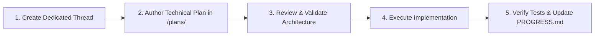
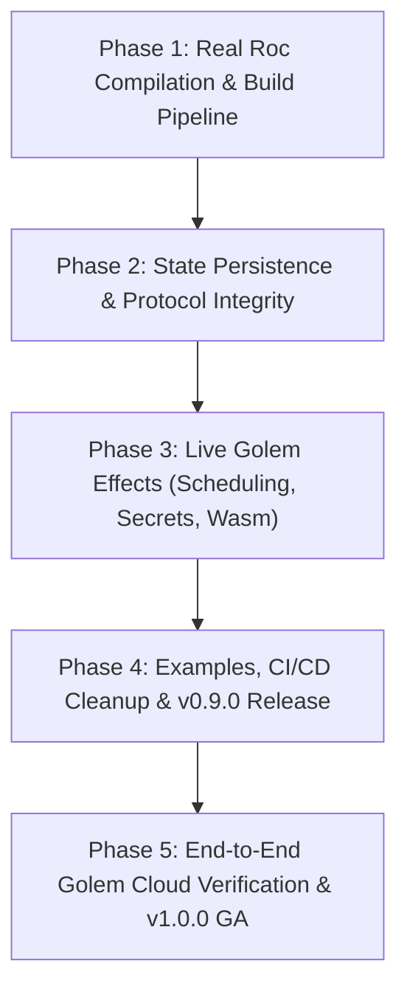

# Roc Golem Platform — Progress, Health & Master Roadmap

> **Status:** Active Reference & Audit Document  
> **Repository:** [`thesparq/roc-golem`](https://github.com/thesparq/roc-golem)  
> **Last Updated:** 2026-11-07  
> **Version Target:** `v0.9.0` (Milestone 1) $\rightarrow$ `v1.0.0` (Production GA)

---

## 📌 Executive Audit Summary

The **Roc Golem Platform** aims to allow developers to build durable, stateful AI agents, workflows, and streaming services in the [Roc programming language](https://www.roc-lang.org) deployed to [Golem Cloud](https://golem.cloud).

An exhaustive audit of the codebase confirms:
1. **The Roc SDK & Host API surface is comprehensive:** Roc and the Rust host agree on 53 distinct low-level host effects and abstractions covering Golem 1.6+ features (HTTP streaming, WebSockets, RDBMS, Promises, Webhooks, Oplog, and Tracing).
2. **Current Component Generation Is Simulated:** The build pipeline (`tooling/build.sh`) currently packages the Rust host compiled with a mock guest bridge (`stub-guest`), rather than compiling and linking the user's Roc code.
3. **Critical State & Runtime Bugs Exist:** Unescaped state JSON in `platform/main.roc` causes state persistence to fail silently; scheduled RPC calls do nothing; and filesystem/secret calls rely on host-native Rust APIs rather than WASI/Golem interfaces.

This document serves as the single source of truth for **what is done**, **what is stubbed/simulated**, **what is defective**, and **what remains to be built**.

---

## 📊 Master Capability Matrix

| Area / Subsystem | Feature / Capability | Status | Implementation Details / Gaps |
| :--- | :--- | :--- | :--- |
| **Platform SDK (Roc)** | Multi-Agent Bundling (`bundle`) | ✅ **Done** | Pure functional agent grouping with erased closures (`platform/Golem.roc`). |
| | Typed Methods (`Method(in, out)`) | ✅ **Done** | Phantom-typed method constructors & typed codecs (`registerTyped`). |
| | Ephemeral Workers (`defineEphemeral`) | ✅ **Done** | Stateless worker specs with zero-state lifecycle. |
| | Read-Only Bypass (`registerReadOnly`) | ⚠️ **Partial** | Spec emits `stateChanged: Bool.false`, but state envelope bug breaks parsing. |
| | State Serialization Envelope | 🔴 **Broken** | `main.roc` emits raw unescaped JSON for state, producing malformed JSON. |
| | In-Guest JSON Parsing | 🔴 **Fragile** | Naive string splitting (`"\"${key}\":\""`) fails on spaces, numbers, booleans, escapes. |
| **Host Bridge (Rust)** | Golem WIT Bindings (`world.wit`) | ✅ **Done** | Updated to `golem:agent/guest@2.0.0` and Golem 1.6 WIT packages. |
| | Roc ABI Bridge (`RocStr`, `RocList`, etc.) | ✅ **Done** | Full Small-String-Optimization (SSO), refcounted lists, custom Roc allocators. |
| | Zero-Serialization Bypass | ✅ **Done** | Host skips state update when state string is empty `""`. |
| | Opaque Secret Handles | ⚠️ **Partial** | Handle tracking exists, but values read from `std::env::var` (missing in WASI guest). |
| | Durable Promises & Webhooks | ⚠️ **Partial** | Real Golem calls behind `wasm32`, but mocks used in unit tests. |
| | WebSocket Client API | ⚠️ **Partial** | Host effects written for `golem:websocket`, but examples do not call them. |
| | Durable RDBMS (Postgres / MySQL) | ⚠️ **Partial** | Implemented with statement caching, but untested against live database. |
| | Durable RPC (`rpc`) | ⚠️ **Partial** | Invokes Golem RPC client, but always uses empty `{}` constructor. |
| | Scheduled RPC (`rpcSchedule`) | 🔴 **Not Implemented** | Unconditionally returns mock `"status": "scheduled"` without scheduling. |
| | Filesystem I/O (`readFile`, `writeFile`) | 🔴 **Broken on WASI** | Calls native `std::fs` instead of WASI filesystem. Missing from `world.wit`. |
| | Logging (`log*`) | ⚠️ **Partial** | Uses `println!`, which is unrouted in production Golem components. |
| **Build & Tooling** | Platform Tarball Packager | ✅ **Done** | BLAKE3 base64url checksums, `.tar.zst`, `.tar.br`, `.tar.gz` generation. |
| | Host Wasm32 Compilation | ✅ **Done** | Builds `libhost.a` and `host.wasm` cleanly under `cargo build --target wasm32`. |
| | Roc App Compilation | 🔴 **Not Implemented** | `build.sh` only calls `roc fmt`; it never invokes `roc build` or links with `libhost.a`. |
| | Separation of Stubs from Host | 🔴 **Broken** | `stub-guest` feature is enabled by default and baked into release `libhost.a`. |
| | Native Cargo Tests | ⚠️ **Fails on Linux** | Building `cdylib` triggers GNU `ld` version-script failure with WIT mangled names. |
| **CI / CD & Releases** | GitHub Actions Workflows | ⚠️ **Defective** | Duplicate workflows (`ci.yaml` vs `ci.yml`) with conflicting commands. |
| | Examples & Docs | ⚠️ **Inaccurate** | README deploy instructions call deprecated WIT interface; examples fake effects. |

---

## 🔍 Detailed Component Analysis

### 1. The Compilation & Linking Pipeline (`tooling/build.sh`)
- **Current Behavior:**
  Running `./tooling/build.sh counter` formats the Roc source file (if `roc` is installed), skips compilation, and runs `wasm-tools component new "$PRECOMPILED_HOST_WASM" -o "$OUTPUT_COMPONENT"`.
- **The Core Issue:**
  The output component is merely the Rust host compiled with `guest_bridge.rs` (a hardcoded mock of `counter`, `diagnostics-worker`, etc.). The user's Roc code is never compiled into WebAssembly or linked.
- **Required Fix:**
  1. Compile user Roc code to an object file: `roc build --target wasm32 --no-link <app.roc>`
  2. Link the Roc object file with `libhost.a` using `wasm-ld` or Roc's native linker.
  3. Ensure `libhost.a` is compiled with `--no-default-features` (without `stub-guest`).
  4. Componentize the linked core wasm module: `wasm-tools component new <linked.wasm> -o <component.wasm>`.

---

### 2. State Serialization & Persistence Bug (`platform/main.roc`)
- **Current Behavior:**
  In `main_handle_message_for_host`:
  ```roc
  escaped_response = escape_json_str(res.response)
  Ok("{\"state\":\"${res.nextStateJson}\",\"response\":\"${escaped_response}\"}")
  ```
- **The Core Issue:**
  `res.nextStateJson` is a serialized JSON object (e.g. `{"count": 1}`). Because it is enclosed in quotes without string escaping (`"state":"{\"count\": 1}"` vs `"state":"{"count": 1}"`), the resulting envelope is **invalid JSON syntax**.
  When the Rust host receives this string, `serde_json::from_str` fails. The host cannot read `"state"`, so the agent reverts to its initial state on every subsequent invocation.
- **Required Fix:**
  Escape `nextStateJson` properly using `escape_json_str(res.nextStateJson)`, or output a single raw JSON envelope:
  `"{\"state\":${res.nextStateJson},\"response\":\"${escaped_response}\"}"`.

---

### 3. In-Guest JSON Decoding (`platform/main.roc`)
- **Current Behavior:**
  ```roc
  extract_json_field = |json, field_name| {
      target = "\"${field_name}\":\""
      ...
  }
  ```
- **The Core Issue:**
  Searching for the literal string `"field":"` fails whenever:
  - There is whitespace (e.g. `"field": "value"`).
  - The value is a number or boolean (e.g. `"id": 123` or `"success": true`).
  - Values contain escaped quotes.
- **Required Fix:**
  Replace hand-rolled string slicing with a standard JSON parser or Roc's built-in `Decode` / `json` library.

---

### 4. Stubbed & Incomplete Host Effects (`host/src/lib.rs`)
- **Scheduled RPC (`rocFxRpcSchedule` / `rocFxRpcScheduleBytes`):**
  Unconditionally returns a JSON string `{"status": "scheduled"}` without calling any Golem scheduling APIs.
- **Filesystem I/O:**
  Uses Rust's native `std::fs` methods (`std::fs::read`, `std::fs::write`). These will trap or fail at runtime in a Wasm32 component unless WASI filesystem interfaces are added to `wit/world.wit` and configured in Golem.
- **Secrets Management:**
  Pulls secrets from `std::env::var`, which is empty inside Wasm components. Must be wired to Golem's configuration store (`wasi:config/store`) or Golem metadata.
- **Hardcoded Canary HTTP Mount:**
  `host/src/lib.rs` explicitly checks `if name == "canary-release"` to attach `/canary/{id}` HTTP mounts. This logic should be driven purely by metadata provided by the Roc agent.

---

### 5. CI / CD & Linux Host Linker Issues
- **Duplicate Workflows:**
  Both `.github/workflows/ci.yaml` and `.github/workflows/ci.yml` exist, testing different things under conflicting configurations.
- **Linux Crate Linker Bug:**
  `host/Cargo.toml` specifies `crate-type = ["staticlib", "cdylib", "rlib"]`. When compiling a `cdylib` on Linux, GNU `ld` attempts to generate a symbol version script. Because `wit-bindgen` exports symbol names containing `:`, `@`, and `#`, the linker syntax parser errors out.
  Running `cargo test --lib` bypasses this, but `cargo test --all-targets` fails.

---

## 🚀 Future Feature Workflow & Governance

Starting immediately, all future work on the platform will adhere to a strict, structured protocol:



### Standardized Execution Rules
1. **One Thread per Feature / Workstream:** Every major bug fix, subsystem upgrade, or feature implementation must occur in a dedicated task thread.
2. **Pre-Implementation Specification:** Before any code is edited or committed, a formal specification must be created in the `plans/` directory (e.g. `plans/01-real-roc-build-pipeline.md`).
3. **No Hidden Mock Stubs:** Production builds of `libhost.a` must never contain mock agent code. Stubs must be confined to test harnesses.
4. **Living Progress Document:** This file (`plans/PROGRESS.md`) must be kept up to date at the conclusion of each milestone.

---

## 🗺️ Phased Milestone Roadmap to v1.0.0



### Phase 1: Real Roc Compilation & Build Pipeline (Immediate Priority)
- [ ] Decouple `stub-guest` into an optional test-only feature in `host/Cargo.toml`.
- [ ] Update `tooling/build.sh` to compile user Roc apps using `roc build --target wasm32`.
- [ ] Implement the linking step using `wasm-ld` to link `app.o` with clean `libhost.a`.
- [ ] Componentize the resulting WebAssembly binary with `wasm-tools component new`.

### Phase 2: State Persistence & Protocol Integrity
- [ ] Fix state JSON serialization in `platform/main.roc` to prevent invalid JSON envelopes.
- [ ] Replace naive string splitting in `main.roc` with robust JSON decoding.
- [ ] Remove hardcoded `canary-release` special cases from `host/src/lib.rs`.
- [ ] Ensure agent errors are cleanly reported without being swallowed by tool-call fallbacks.

### Phase 3: Live Golem Effects
- [ ] Implement real Golem Cloud scheduling for `rpcSchedule` and `rpcScheduleBytes`.
- [ ] Wire secret handles to Golem configuration store (`wasi:config/store`) instead of `std::env::var`.
- [ ] Replace `std::fs` with WASI filesystem imports or document Key-Value / Blobstore as preferred durable storage.
- [ ] Route `log*` effects through WASI / Golem logging.

### Phase 4: Examples, CI/CD & Documentation (v0.9.0)
- [ ] Consolidate `.github/workflows/ci.yaml` and `.github/workflows/ci.yml` into a single canonical workflow.
- [ ] Fix Linux `cargo test` failure by gating `cdylib` for `wasm32` only.
- [ ] Update `examples/counter/main.roc`, `examples/streaming_agent/main.roc`, and `canary_release` to exercise real effects.
- [ ] Update README with accurate Golem 1.6 deploy commands and release hashes.
- [ ] Tag and publish release `v0.9.0`.

### Phase 5: Live Verification & GA (v1.0.0)
- [ ] Deploy compiled Roc agents to a live Golem Cloud worker.
- [ ] Verify durable state persistence across worker suspension and restarts.
- [ ] Verify bi-directional WebSocket streaming on live Golem infrastructure.
- [ ] Tag `v1.0.0` Production Release.
